<div align="center">

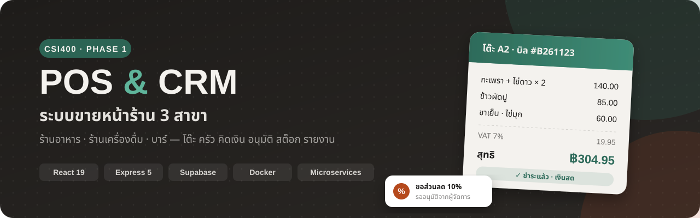

<br>

**ระบบ POS หลายสาขา** สำหรับร้านอาหาร · ร้านเครื่องดื่ม · บาร์<br>
เปิดโต๊ะ สั่งอาหาร ส่งเข้าครัว คิดเงิน ขออนุมัติส่วนลด/คืนเงิน จัดการเมนูและสต็อก พร้อมแดชบอร์ดกำไรรายสาขา

<br>

[](https://github.com/noinahjajah/Pos_Crm/actions/workflows/test.yml)
[](เอกสาร/UAT.md)


<br>

[**▶️ Prototype**](https://www.figma.com/proto/pWc3YWHYawV6L3Ykm57Ke5?node-id=3-2&starting-point-node-id=3%3A2) &nbsp;·&nbsp;
[**🎨 Figma**](https://www.figma.com/design/pWc3YWHYawV6L3Ykm57Ke5) &nbsp;·&nbsp;
[**📄 รายงาน**](เอกสาร/REPORT.md) &nbsp;·&nbsp;
[**🧪 UAT**](เอกสาร/UAT.md) &nbsp;·&nbsp;
[**📋 Spec**](เอกสาร/pos-crm-phase1-spec.md) &nbsp;·&nbsp;
[**🚀 เริ่มใช้งาน**](#-เริ่มต้นใช้งาน)

<br>

<table>
  <tr>
    <td align="center" width="25%"><h3>4</h3>microservices<br><sub>identity · catalog · pos · payment</sub></td>
    <td align="center" width="25%"><h3>3</h3>ผู้จัดทำ<br><sub>เปมิกา · วรัตถา · ภัทรพล</sub></td>
    <td align="center" width="25%"><h3>48 / 49</h3>UAT ผ่าน<br><sub>ไม่มีเคสที่ไม่ผ่าน</sub></td>
    <td align="center" width="25%"><h3>155</h3>test อัตโนมัติ<br><sub>รันทุก Pull Request</sub></td>
  </tr>
</table>

</div>

---

## 📸 หน้าจอ

<table>
  <tr>
    <td width="50%">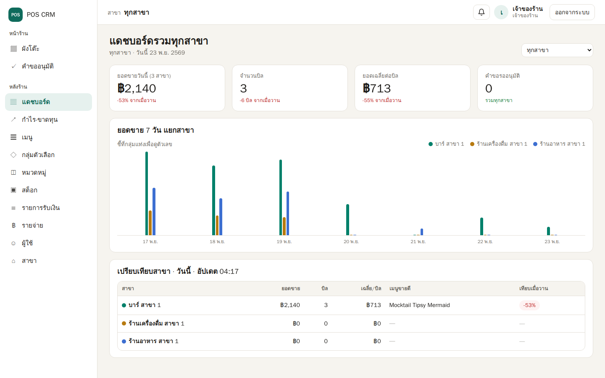<p align="center"><b>แดชบอร์ดรวมทุกสาขา</b><br><sub>owner · ยอดขาย 7 วัน เปรียบเทียบสาขา</sub></p></td>
    <td width="50%">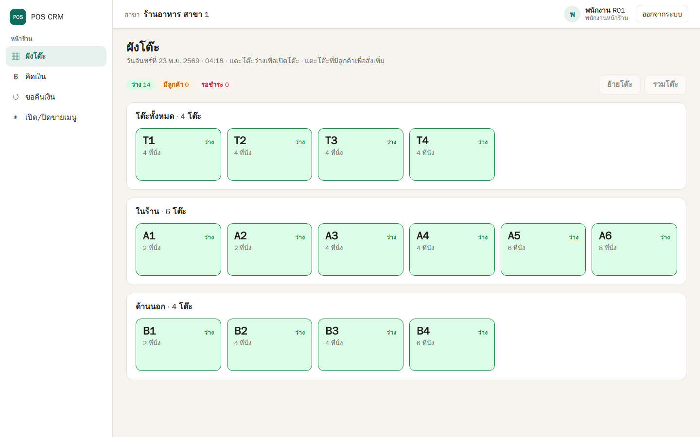<p align="center"><b>ผังโต๊ะ</b><br><sub>staff · แยกโซน ในร้าน / ด้านนอก · สถานะโต๊ะ</sub></p></td>
  </tr>
  <tr>
    <td width="50%">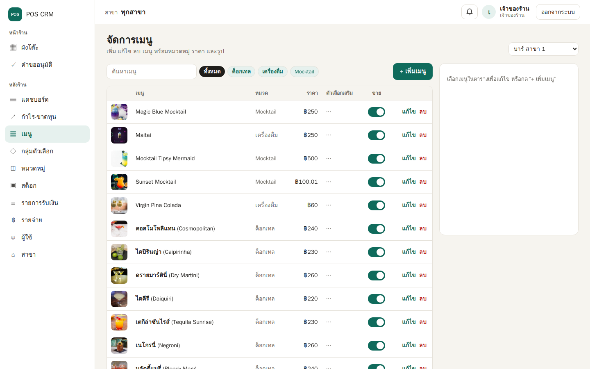<p align="center"><b>จัดการเมนู</b><br><sub>manager · owner · รูป ราคา หมวด เปิด/ปิดขาย</sub></p></td>
    <td width="50%">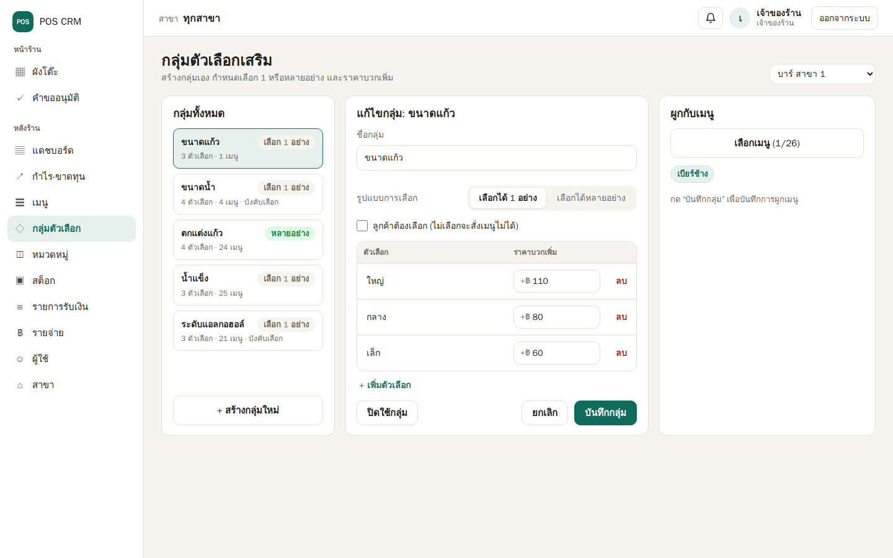<p align="center"><b>กลุ่มตัวเลือกเสริม</b><br><sub>ขนาด น้ำแข็ง ท็อปปิ้ง · ราคาบวกเพิ่ม</sub></p></td>
  </tr>
</table>

<details>
<summary><b>หน้าเข้าสู่ระบบ</b></summary>
<br>
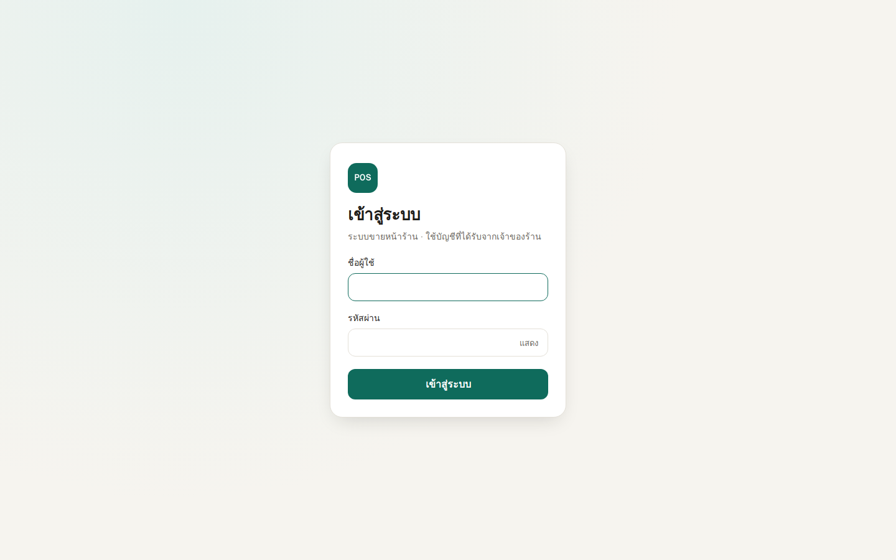
</details>

---

## 👥 ผู้จัดทำ

| รหัสนักศึกษา | ชื่อ-นามสกุล | ตำแหน่ง | รับผิดชอบ | GitHub |
|---|---|---|---|---|
| 67167033 | เปมิกา เมฆลอย | Full Stack Developer | ลูกมือทีม · เอกสาร · UAT · รายงาน · README | [@l0w0l-0](https://github.com/l0w0l-0) |
| 67133846 | วรัตถา เตนากุล | Full Stack Developer | catalog · payment · รายงาน | [@warattha48](https://github.com/warattha48) |
| 67180663 | ภัทรพล ถ่อมดี | Full Stack Developer | pos (โต๊ะ ออร์เดอร์ ครัว อนุมัติ) | [@noinahjajah](https://github.com/noinahjajah) |

> จัดทำในรายวิชา **CSI400 – เว็บเซอร์วิส**

---

## 📑 สารบัญ

- [หน้าจอ](#-หน้าจอ)
- [ภาพรวมระบบ](#-ภาพรวมระบบ)
- [Prototype (Figma)](#-prototype-figma)
- [สถาปัตยกรรม](#️-สถาปัตยกรรม)
- [ความคืบหน้า](#-ความคืบหน้า)
- [โครงสร้าง Repository](#-โครงสร้าง-repository)
- [เริ่มต้นใช้งาน](#-เริ่มต้นใช้งาน)
- [ผู้ใช้และสิทธิ์](#-ผู้ใช้และสิทธิ์)
- [API](#-api)
- [ฐานข้อมูล](#️-ฐานข้อมูล)
- [Flow สำคัญ](#-flow-สำคัญ)
- [กติกาทางธุรกิจ](#-กติกาทางธุรกิจ)
- [เอกสาร รายงาน และ UAT](#-เอกสาร-รายงาน-และ-uat)
- [แนวทางการทำงานร่วมกัน](#-แนวทางการทำงานร่วมกัน)

---

## ✨ ภาพรวมระบบ

| ด้าน | ทำอะไรได้ |
|---|---|
| 🪑 **หน้าร้าน** | เปิดโต๊ะ ย้าย/รวมโต๊ะ สั่งอาหารหลายรอบ เลือกตัวเลือก ใส่หมายเหตุ |
| 👨‍🍳 **ครัว** | ใบออร์เดอร์เข้าครัว จอครัวแจ้งตั๋วใหม่แบบ realtime |
| 💵 **คิดเงิน** | เงินสดพร้อมคิดเงินทอน · PromptPay (จำลอง) · ใบเสร็จแยก VAT |
| ✅ **อนุมัติ** | พนักงานขอส่วนลด/คืนเงิน → ผู้จัดการและเจ้าของอนุมัติแบบ realtime |
| 📦 **เมนูและสต็อก** | เมนูแยกตามสาขา กลุ่มตัวเลือก สต็อกตัดอัตโนมัติ หมดแล้วปิดขายเอง |
| 📊 **หลังร้าน** | รายจ่าย 4 หมวด · แดชบอร์ดรายวัน · เปรียบเทียบสาขา · กำไรรายเดือน |

---

## 🎨 Prototype (Figma)

ออกแบบหน้าจอก่อนลงมือเขียนโค้ด สี ฟอนต์ และ component ของเว็บใช้ตามไฟล์นี้

| | ลิงก์ |
|---|---|
| ▶️ **ทดลองกดใช้งาน** | [เปิด Prototype](https://www.figma.com/proto/pWc3YWHYawV6L3Ykm57Ke5?node-id=3-2&starting-point-node-id=3%3A2) · เริ่มที่หน้า Login |
| 🎨 **ไฟล์ออกแบบ** | [เปิดไฟล์ Figma](https://www.figma.com/design/pWc3YWHYawV6L3Ykm57Ke5) |

| # | หน้าจอ | Role | หน้าที่ |
|:---:|---|:---:|---|
| 01 | [Login](https://www.figma.com/design/pWc3YWHYawV6L3Ykm57Ke5?node-id=3-2) · บัญชีทดสอบแยกตาม role | ทุก role | เปมิกา เมฆลอย|
| 02 | [Owner Dashboard](https://www.figma.com/design/pWc3YWHYawV6L3Ykm57Ke5?node-id=3-74) · ภาพรวมทุกสาขา | O | วรัตถา เตนากุล |
| 03 | [Manager Dashboard](https://www.figma.com/design/pWc3YWHYawV6L3Ykm57Ke5?node-id=4-56) · เห็นเฉพาะสาขาตัวเอง | M | ภัทรพล ถ่อมดี |
| 04 | [จัดการผู้ใช้](https://www.figma.com/design/pWc3YWHYawV6L3Ykm57Ke5?node-id=4-237) · กำหนด role และสาขา | O |  ภัทรพล ถ่อมดี |
| 05 | [คำขอรออนุมัติ](https://www.figma.com/design/pWc3YWHYawV6L3Ykm57Ke5?node-id=5-137) · อนุมัติ/ปฏิเสธ ส่วนลดและคืนเงิน | M O | วรัตถา เตนากุล |
| 06 | [Audit Log](https://www.figma.com/design/pWc3YWHYawV6L3Ykm57Ke5?node-id=5-385) · ใคร ทำอะไร ที่ไหน เมื่อไหร่ | O | ภัทรพล ถ่อมดี |

**วิธีดู:** เปิดลิงก์ Prototype แล้วคลิกบนหน้าจอได้เลย — **เข้าสู่ระบบ** → Owner Dashboard · บัญชีทดสอบ Owner/Manager → แดชบอร์ดของ role นั้น · เมนูซ้ายสลับหน้า · ชื่อผู้ใช้มุมล่างซ้าย → กลับหน้า Login

**Design system:** Button · Badge · NavItem · KPI · Input (กรอบ 🧩 Components ในไฟล์) · ฟอนต์ IBM Plex Sans Thai

| สี | Hex | ใช้กับ |
|---|---|---|
| 🟩 เขียว | `#2E6B5A` | ปุ่มหลัก เมนูที่เลือก |
| 🟫 น้ำตาล | `#B5481E` | ปุ่มอันตราย คืนเงิน |
| ⬛ เข้ม | `#1E1C1A` | แถบเมนูด้านซ้าย ตัวอักษร |
| ⬜ พื้น | `#F4F2EE` | พื้นหลังหน้า |

---

## 🏗️ สถาปัตยกรรม

แยกเป็น **microservices** ทุก request จากหน้าเว็บผ่าน **API Gateway** ที่เดียว
ใช้ Supabase project เดียว แต่แบ่ง **schema ตาม service** และไม่มี foreign key ข้าม schema

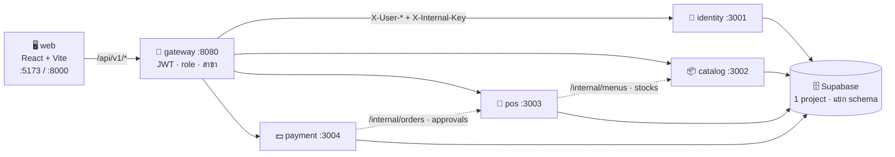

| | |
|---|---|
| 🔐 **Gateway** | ตรวจ JWT · เช็ก role · กำหนดสาขา · แนบ header `X-User-*` + `X-Internal-Key` แล้วส่งต่อ |
| 🔒 **Service** | ไม่เปิด port ออกนอก เชื่อ header เฉพาะเมื่อ `X-Internal-Key` ถูกต้อง |
| 🔗 **Internal API** | `/internal/*` ให้ service เรียกกันเองเท่านั้น gateway บล็อกจากภายนอกเสมอ |
| ⚡ **Realtime** | แจ้งคำขออนุมัติให้ผู้จัดการทันทีผ่าน SSE (`/approvals/stream`) โดยไม่ต้องรีเฟรช |

---

## 📈 ความคืบหน้า

> ✅ อยู่ใน `main` แล้ว · 🧩 มีไฟล์แล้ว ยังไม่เปิดใช้งาน · 🔄 รอ Pull Request

| ส่วน | ผู้รับผิดชอบ | สถานะ | หมายเหตุ |
|---|---|:---:|---|
|  identity service | เปมิกา | ✅ | login · refresh · ผู้ใช้ · สาขา · role ใน JWT (schema `identity1`) |
|  gateway | เปมิกา | ✅ | ตรวจ JWT · ตารางสิทธิ์แบบปฏิเสธไว้ก่อน · rate limit · proxy · SSE |
|  login · layout · ผู้ใช้ · สาขา · งานพิมพ์ | เปมิกา | ✅ | router · `api/client.js` · layout ทั้งแอป · ใบแจ้งยอด/ใบเสร็จ 58 มม. |
|  Docker Compose ทั้งระบบ | ทุกคน | ✅ | `docker compose up` · โหมดพัฒนา · healthcheck ทุก service |
|  catalog service | วรัตถา | ✅ | หมวด เมนู (รูป) ตัวเลือก สต็อก คัดลอกเมนู internal API |
|  payment service | วรัตถา | ✅ | รับเงิน คืนเงิน รายจ่าย รายงาน · เรียก pos จริง (`POS_MODE=http`) |
|  หน้าหลังร้าน + หน้าคิดเงิน | วรัตถา | ✅ | เมนู ตัวเลือก สต็อก รายจ่าย รายงาน กำไร คิดเงิน |
|  pos service | ภัทรพล | ✅ | โต๊ะ บิล ตั๋วครัว ย้าย/รวมโต๊ะ คำขออนุมัติ |
|  ผังโต๊ะ · สั่งอาหาร · อนุมัติ | ภัทรพล | ✅ | หน้าโต๊ะ หน้าบิล คำขออนุมัติ realtime |
|  จอครัว (`/kitchen`) | ภัทรพล | 🧩 | มี `KitchenPage.jsx` แล้ว ยังคอมเมนต์ปิดใน `router.jsx` และ `navItems.js` |
|  SQL ของฐานข้อมูล | ทุกคน | ✅ | `supabase/migrations/` (4 schema) · `supabase/tests/` |
|  เอกสาร (README · UAT · รายงาน) | เปมิกา | ✅ | ทดสอบ UAT 49 เคส · รายงานโปรเจกต์ · คู่มือติดตั้งและใช้งาน |
|  CI | เปมิกา | 🔄 | [PR #6](https://github.com/noinahjajah/Pos_Crm/pull/6) |

ผลทดสอบ: **UAT ผ่าน 48 / 49 เคส** (เหลือ UAT-16 จอครัว) · **test อัตโนมัติ 155 ข้อผ่าน** — รายละเอียดใน [📄 รายงานโปรเจกต์](เอกสาร/REPORT.md) และ [🧪 UAT](เอกสาร/UAT.md)

---

## 📁 โครงสร้าง Repository

```text
Pos_Crm/
├── .github/workflows/test.yml   🤖 CI รัน npm test ทุก service ทุก Pull Request
├── services/
│   ├── gateway/        🚪 :8080  ตรวจ JWT · ตารางสิทธิ์ · rate limit · proxy
│   │   ├── src/              access.config.js (ตารางสิทธิ์) · verifyToken.js · proxy.js · app.js
│   │   └── test/
│   ├── identity/       👤 :3001  login · ผู้ใช้ · สาขา · role
│   │   └── auth.js · users.js · branches.js · me.js · internal.js
│   ├── catalog/        📦 :3002  หมวดหมู่ · เมนู · ตัวเลือก · สต็อก
│   │   └── categories.js · menus.js · optionGroups.js · stocks.js · internal.js
│   ├── pos/            🧾 :3003  โต๊ะ · บิล · ตั๋วครัว · คำขออนุมัติ
│   │   └── tables.js · orders.js · kitchen.js · approvals.js · events.js (SSE) · internal.js
│   ├── payment/        💵 :3004  รับเงิน · คืนเงิน · รายจ่าย · รายงาน
│   │   └── payments.js · expenses.js · reports.js · pos.js (เรียก pos)
│   └── _shared-test/   contract test ที่ใช้ร่วมกัน
│   (ทุก service มี server.js · db.js · helpers.js · Dockerfile · .env.example · test/)
├── web/                🖥️  React 19 + Vite
│   ├── src/
│   │   ├── app/        router · providers · หน้าแรกตาม role
│   │   ├── api/        ที่เดียวที่เรียก backend (1 ไฟล์ต่อ 1 service)
│   │   └── features/
│   │       ├── auth/         login · RequireRole
│   │       ├── tables/       ผังโต๊ะ · เปิด/ย้าย/รวมโต๊ะ
│   │       ├── orders/       หน้าบิล · สั่งอาหาร · เลือกตัวเลือก
│   │       ├── kitchen/      จอครัว (ยังปิดใช้งาน)
│   │       ├── checkout/     คิดเงิน · PromptPay จำลอง · ใบเสร็จ
│   │       ├── approvals/    ขอ/อนุมัติส่วนลดและคืนเงิน
│   │       └── backoffice/   menus/ stocks/ expenses/ payments/ reports/ users/
│   ├── Dockerfile      dev (Vite) / build / nginx
│   └── nginx.conf      ส่ง /api ต่อให้ gateway
├── supabase/
│   ├── migrations/     identity1 · catalog · payment · pos
│   └── tests/          SQL smoke test
├── docker-compose.yml      รันทั้งระบบ (เว็บ :8000)
├── docker-compose.dev.yml  โหมดพัฒนา แก้โค้ดแล้ว reload เอง (เว็บ :5173)
└── เอกสาร/
    ├── pos-crm-phase1-spec.md         ฟีเจอร์ · ERD · API · แบ่งงาน
    ├── frontend-folder-structure.md   โครงสร้าง web
    ├── POS-CRM-Database-Microservices.png
    ├── REPORT.md                      รายงานโปรเจกต์
    └── UAT.md                         ผลการทดสอบ UAT 49 เคส
```

---

## 🚀 เริ่มต้นใช้งาน

### สิ่งที่ต้องมี

- **Docker Desktop** (แนะนำ) หรือ **Node.js 22**
- โปรเจกต์ **Supabase** ของทีม (ขอ URL และ key จากหัวหน้าทีม) ที่รัน SQL ใน `supabase/migrations/` ตามลำดับแล้ว และเปิด **Exposed schemas**: `identity1` `catalog` `pos` `payment`

### 1. ตั้งค่า `.env` ของแต่ละ service

คัดลอก `.env.example` เป็น `.env` ในทุก service แล้วใส่ค่าจริง

```bash
for s in gateway identity catalog pos payment; do cp services/$s/.env.example services/$s/.env; done
```

```env
INTERNAL_KEY=ต้องเหมือนกันทุก service
SUPABASE_URL=https://xxxx.supabase.co
SUPABASE_SERVICE_ROLE_KEY=sb_secret_xxxx    # ใช้ฝั่ง server เท่านั้น
SUPABASE_JWT_SECRET=...                     # gateway: ตรวจ JWT
MENU_IMAGE_BUCKET=menu-images               # catalog: bucket รูปเมนู
POS_MODE=http                               # payment: http = เรียก pos จริง (Docker ตั้งให้แล้ว)
```

> [!CAUTION]
> ห้าม commit ไฟล์ `.env` และห้ามใส่ `SUPABASE_SERVICE_ROLE_KEY` ในหน้าเว็บ key นี้ข้ามสิทธิ์ทุกอย่างในฐานข้อมูล

### 2a. รันด้วย Docker (แนะนำ)

```bash
docker compose up -d --build       # เว็บ http://localhost:8000
docker compose ps                  # ทุก service ต้องเป็น healthy
docker compose down                # ปิด

# โหมดพัฒนา: แก้โค้ดแล้ว reload เอง · เว็บ http://localhost:5173
docker compose -f docker-compose.yml -f docker-compose.dev.yml up -d --build
```

> ใน Docker ค่า `IDENTITY_URL` `CATALOG_URL` `POS_URL` `PAYMENT_URL` และ `POS_MODE=http` ตั้งไว้ใน `docker-compose.yml` แล้ว

### 2b. รันทีละ service (ไม่ใช้ Docker)

เปิด terminal แยกทีละตัว และใส่ `IDENTITY_URL` `CATALOG_URL` `POS_URL` `POS_MODE=http` ใน `.env` เองตาม `.env.example`

```bash
cd services/identity && npm install && npm run dev   # :3001
cd services/catalog  && npm install && npm run dev   # :3002
cd services/pos      && npm install && npm run dev   # :3003
cd services/payment  && npm install && npm run dev   # :3004
cd services/gateway  && npm install && npm run dev   # :8080
cd web               && npm install && npm run dev   # :5173
```

### 3. เช็กว่าทำงาน

ทุก service มี `GET /health` · ดูรวมทุก service ได้ที่ gateway

```bash
curl http://localhost:8080/health   # {"status":"ok", ...} identity · catalog · pos · payment = up
```

### 4. รัน test

```bash
cd services/<ชื่อ service> && npm ci && npm test   # ไม่ต้องใช้ .env หรือ Supabase
```

GitHub Actions รัน test ของ catalog · gateway · identity · payment · pos ให้อัตโนมัติทุก Pull Request (ผลล่าสุด 155 / 155 ผ่าน)

---

## 🔑 ผู้ใช้และสิทธิ์

| Role | ใคร | เห็นข้อมูล |
|---|---|---|
| **S** · `staff` | พนักงานหน้าร้าน (รวม waiter + cashier เพราะใช้ POS เครื่องเดียว) | สาขาตัวเอง |
| **M** · `manager` | ผู้จัดการสาขา | สาขาตัวเอง |
| **O** · `owner` | เจ้าของร้าน | ทุกสาขา เลือกดูทีละสาขาด้วย `?branch_id=` |

- ไม่มีสิทธิ์ → **403**
- staff/manager ส่ง `branch_id` ของสาขาอื่นมา → gateway ไม่สนใจ และใช้สาขาจาก JWT แทน

---

## 🔌 API

Base URL: `http://localhost:8080/api/v1/<service>` (ผ่าน gateway)

<details>
<summary><b>👤 identity</b> ✅</summary>

| Method | Path | Role |
|---|---|---|
| POST | `/auth/login` · `/auth/refresh` | public |
| POST | `/auth/logout` | S M O |
| GET | `/me` · `/branches` | S M O |
| POST · PATCH · DELETE | `/branches` · `/branches/:id` | O |
| GET | `/roles` | M O |
| GET | `/users` | M O (manager เห็นเฉพาะสาขาตัวเอง) |
| POST · PATCH · DELETE | `/users` · `/users/:id` | O |

</details>

<details>
<summary><b>📦 catalog</b> ✅</summary>

| Method | Path | Role |
|---|---|---|
| GET | `/categories` · `/menus` · `/menus/:id` · `/option-groups` | S M O |
| PATCH | `/menus/:id/availability` | S M O |
| POST · PATCH · DELETE | `/menus` · `PUT /menus/:id/option-groups` | M O |
| POST · PATCH | `/option-groups` · `/option-groups/:id/options` · `/options/:id` | M O |
| GET · PATCH | `/stocks` · `/stocks/:menuId` (`{quantity}` หรือ `{add}`) | M O |
| POST · PATCH · DELETE | `/categories` (ลบได้เมื่อไม่มีเมนูในหมวด) | O |
| POST | `/menus/:id/copy` | O |

</details>

<details>
<summary><b>🧾 pos</b> ✅</summary>

| Method | Path | Role |
|---|---|---|
| GET | `/tables` · `/orders` · `/orders/:id` | S M O |
| POST · PATCH | `/tables` | M O |
| POST | `/orders` · `/orders/:id/tickets` · `/orders/:id/request-payment` · `/orders/:id/cancel` | S M |
| POST | `/orders/:id/tables/move` · `/orders/:id/tables/merge` | S M |
| GET · PATCH | `/kitchen/tickets` | S M |
| POST | `/orders/:id/approvals` | S |
| GET | `/approvals` (staff เห็นเฉพาะของตัวเอง) | S M O |
| GET | `/approvals/stream` (SSE realtime) | M O |
| POST | `/approvals/:id/approve` · `/approvals/:id/reject` | M O |

</details>

<details>
<summary><b>💵 payment</b> ✅</summary>

| Method | Path | Role |
|---|---|---|
| POST | `/payments` (header `Idempotency-Key`) · `/refunds` | S M |
| GET | `/orders` · `/orders/:id` · `/refunds/approved` | S M |
| GET | `/payments` | M O |
| GET · POST · PATCH · DELETE | `/expenses` | M O |
| GET | `/reports/daily` | M O |
| GET | `/reports/branches` · `/reports/profit` | O |

</details>

<details>
<summary><b>🔗 Internal API</b> (service เรียกกันเอง ต้องมี <code>X-Internal-Key</code>)</summary>

| จาก → ไป | Endpoint | ใช้ตอนไหน |
|---|---|---|
| pos → catalog | `POST /internal/menus/lookup` ✅ | ดึงชื่อ/ราคาไปเก็บ snapshot |
| pos → catalog | `POST /internal/stocks/deduct` ✅ | ตัดสต็อกตอนสั่ง |
| pos → catalog | `POST /internal/stocks/restore` ✅ | คืนสต็อกเมื่อสั่งไม่สำเร็จ |
| payment → pos | `GET /internal/orders/:id/summary` | ยอดที่ต้องจ่ายและสถานะบิล |
| payment → pos | `POST /internal/orders/:id/mark-paid` | ปิดบิล คืนโต๊ะเป็นว่าง |
| payment → pos | `POST /internal/orders/:id/mark-refunded` | อัปเดตบิลหลังคืนเงิน |
| payment → pos | `GET /internal/approvals/:id` | ข้อมูลคำขอคืนเงิน |
| payment → pos | `GET /internal/orders?status=waiting_payment&branch_id=` | บิลรอชำระของสาขา |
| payment → pos | `GET /internal/approvals?type=refund&status=approved&branch_id=` | คำขอคืนเงินที่อนุมัติแล้ว |

</details>

### รูปแบบ response

```jsonc
// สำเร็จ
{ "data": { }, "meta": { "page": 1, "total": 42 } }

// ผิดพลาด
{ "error": { "code": "STOCK_NOT_ENOUGH", "message": "เมนูบางรายการหมด", "details": [] } }
```

| HTTP | ใช้เมื่อ |
|:---:|---|
| `400` | ข้อมูลไม่ถูกต้อง |
| `401` | ไม่ได้ login หรือ token หมดอายุ |
| `403` | role หรือสาขาไม่มีสิทธิ์ |
| `404` | ไม่พบข้อมูล |
| `409` | สถานะไม่ถูกต้อง เช่น สต็อกไม่พอ บิลจ่ายแล้ว |
| `429` | เรียกถี่เกินไป |
| `502` · `504` | service ปลายทางล่มหรือตอบช้า |

---

## 🗄️ ฐานข้อมูล

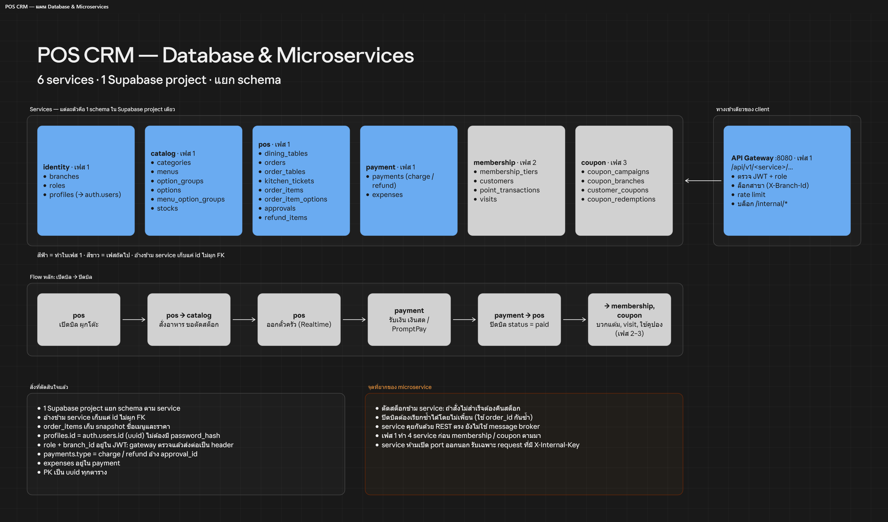

| Schema | ตาราง |
|---|---|
| 👤 `identity1` | `branches` · `roles` · `profiles` (+ `auth.users` ของ Supabase) · custom access token hook |
| 📦 `catalog` | `categories` · `menus` · `option_groups` · `options` · `menu_option_groups` · `stocks` · `stock_movements` |
| 🧾 `pos` | `dining_tables` · `orders` · `order_tables` · `kitchen_tickets` · `order_items` · `order_item_options` · `approvals` · `refund_items` |
| 💵 `payment` | `payments` · `expenses` |

SQL ทั้งหมดอยู่ใน [`supabase/migrations/`](supabase/migrations) · รายละเอียดคอลัมน์และความสัมพันธ์อยู่ใน [`เอกสาร/pos-crm-phase1-spec.md`](เอกสาร/pos-crm-phase1-spec.md) หัวข้อ 3 (spec ยังเขียนชื่อ schema เป็น `identity` ระบบจริงใช้ `identity1`)

---

## 🔄 Flow สำคัญ

### สั่งอาหาร 1 รอบ

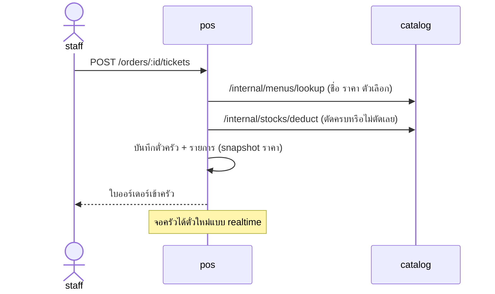

### รับเงิน

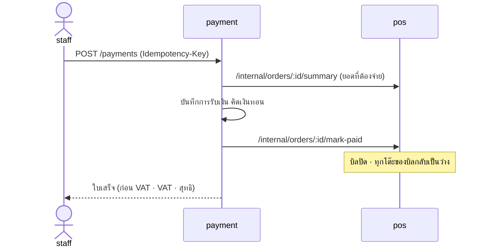

### ขอส่วนลด / คืนเงิน

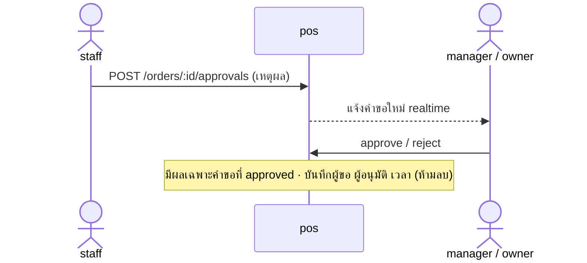

---

## 📐 กติกาทางธุรกิจ

| เรื่อง | กติกา |
|---|---|
| 🧮 **VAT** | `vat = (subtotal − discount) × 7%` · `total = subtotal − discount + vat` |
| 🏷️ **ราคาในบิล** | เก็บชื่อและราคาตอนสั่งเป็น snapshot แก้เมนูทีหลังบิลเก่าไม่เปลี่ยน |
| 📦 **สต็อก** | ตัดทันทีตอนสั่ง (ตัดครบหรือไม่ตัดเลย) · เหลือ 0 ปิดขายอัตโนมัติ · เติมจาก 0 **ไม่**เปิดขายให้ ต้องกดเปิดเอง |
| 🏪 **เมนู** | เป็นของแต่ละสาขา · หมวดหมู่เป็นของกลาง (owner จัดการ ลบได้เมื่อไม่มีเมนูในหมวด) · owner คัดลอกเมนูข้ามสาขาได้ |
| 💳 **การจ่าย** | 1 บิลจ่ายได้ครั้งเดียว · กดซ้ำด้วย `Idempotency-Key` เดิมไม่รับเงินซ้ำ · ไม่มีการแยกบิล |
| ↩️ **คืนเงิน** | เฉพาะบิลที่จ่ายแล้ว · ต้องได้รับอนุมัติ · ไม่คืนสต็อก · คืนรวมไม่เกินยอดที่จ่าย |
| 📝 **คำขออนุมัติ** | บันทึกผู้ขอ ผู้อนุมัติ เวลา เหตุผล · **ห้ามลบ** |
| 📊 **รายงาน** | รายรับ = รับเงิน − คืนเงิน · กำไร = รายรับ − รายจ่าย · นับวันและเดือนตามเวลาไทย |

---

## 📚 เอกสาร รายงาน และ UAT

| เอกสาร | เนื้อหา |
|---|---|
| 📄 [รายงานโปรเจกต์](เอกสาร/REPORT.md) | ที่มา ขอบเขต สถาปัตยกรรม การออกแบบ ความคืบหน้า ปัญหาและแนวทางต่อ |
| 🧪 [UAT](เอกสาร/UAT.md) | ผลทดสอบการยอมรับของผู้ใช้ 49 เคส ครบทุกฟีเจอร์เฟส 1 · ผ่าน 48 · ผ่านบางส่วน 1 · ไม่ผ่าน 0 · พร้อมช่องลงนาม |
| 📋 [Spec เฟส 1](เอกสาร/pos-crm-phase1-spec.md) | ฟีเจอร์ · ERD · API gateway · แบ่งงาน |
| 🗂️ [โครงสร้าง Frontend](เอกสาร/frontend-folder-structure.md) | การแบ่งโฟลเดอร์ของ `web/` |
| 🎨 [Figma](https://www.figma.com/design/pWc3YWHYawV6L3Ykm57Ke5) | Prototype หน้าจอและ design system |

| หมวด UAT | ผู้รับผิดชอบ | เคส | ✅ ผ่าน |
|---|---|:---:|:---:|
| 👤 ผู้ใช้ สิทธิ์ และสาขา | เปมิกา | 10 | 10 |
| 🪑 โต๊ะและออร์เดอร์ | ภัทรพล | 9 | 8 (+1 บางส่วน) |
| 📦 เมนู ตัวเลือก สต็อก | วรัตถา | 11 | 11 |
| 💵 ชำระเงินและอนุมัติ | วรัตถา · ภัทรพล | 12 | 12 |
| 📊 รายจ่ายและแดชบอร์ด | วรัตถา | 7 | 7 |
| **รวม** | | **49** | **48** |

---

## 🤝 แนวทางการทำงานร่วมกัน

| เรื่อง | ข้อตกลง |
|---|---|
| 🌿 **Branch** | ทำงานใน branch ของตัวเอง → เปิด Pull Request เข้า `main` ให้เพื่อนตรวจก่อน merge |
| 🔄 **ก่อน push** | `git fetch origin` → `git merge origin/main` แก้ conflict ให้เรียบร้อยก่อน |
| 🤖 **CI** | Pull Request ต้องผ่าน test ของทุก service (GitHub Actions) ก่อน merge |
| 🗂️ **ขอบเขตไฟล์** | แก้เฉพาะ service และโฟลเดอร์ใน `features/` ของตัวเอง ไฟล์กลางตกลงกันก่อน |
| 🗄️ **ฐานข้อมูล** | แต่ละ service ใช้ schema ของตัวเองเท่านั้น ข้อมูลข้าม service ขอผ่าน API |
| 🔐 **ความลับ** | `.env` ไม่ขึ้น git · แชร์ key ผ่านช่องทางส่วนตัวของทีม |

<div align="center">

---

**POS & CRM** · เฟส 1 · CSI400 เว็บเซอร์วิส

</div>
