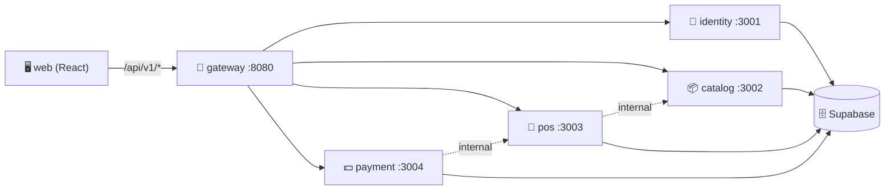

# 📄 รายงานโปรเจกต์ — POS & CRM ระบบขายหน้าร้าน 3 สาขา (เฟส 1)

> รายวิชา **CSI400 – เว็บเซอร์วิส** · Repository [noinahjajah/Pos_Crm](https://github.com/noinahjajah/Pos_Crm)

| รหัสนักศึกษา | ชื่อ-นามสกุล | รับผิดชอบ |
|---|---|---|
| 67167033 | เปมิกา เมฆลอย | Dev 1 · identity · gateway · Docker · หน้า login/layout/ผู้ใช้/สาขา · งานพิมพ์ |
| 67133846 | วรัตถา เตนากุล | Dev 2 · catalog · payment · รายงาน · หน้าหลังร้านและคิดเงิน |
| 67180663 | ภัทรพล ถ่อมดี | Dev 3 · pos · หน้าโต๊ะ สั่งอาหาร จอครัว คำขออนุมัติ |

---

## สารบัญ

1. [บทนำ](#1-บทนำ)
2. [ผู้ใช้และความต้องการของระบบ](#2-ผู้ใช้และความต้องการของระบบ)
3. [สถาปัตยกรรมและเทคโนโลยี](#3-สถาปัตยกรรมและเทคโนโลยี)
4. [การออกแบบ](#4-การออกแบบ)
5. [การพัฒนาและความคืบหน้า](#5-การพัฒนาและความคืบหน้า)
6. [การทดสอบ](#6-การทดสอบ)
7. [ปัญหาที่พบและแนวทางแก้ไข](#7-ปัญหาที่พบและแนวทางแก้ไข)
8. [แผนงานต่อไป](#8-แผนงานต่อไป)
9. [สรุป](#9-สรุป)

---

## 1. บทนำ

### 1.1 ที่มาและความสำคัญ

ร้านที่มี 3 สาขา (ร้านอาหาร · ร้านเครื่องดื่ม · บาร์) จดออร์เดอร์ คิดเงิน และสรุปยอดแยกกันในแต่ละสาขา
เจ้าของร้านจึงเห็นภาพรวมได้ช้า การให้ส่วนลดหรือคืนเงินไม่มีหลักฐานว่าใครอนุมัติ และสต็อกไม่ตรงกับยอดขายจริง

### 1.2 วัตถุประสงค์

1. พนักงานหน้าร้านเปิดโต๊ะ สั่งอาหาร ส่งเข้าครัว และคิดเงินได้ในเครื่อง POS เครื่องเดียว
2. แยกสิทธิ์ตามบทบาท (staff · manager · owner) และแยกข้อมูลตามสาขา
3. ส่วนลดและการคืนเงินต้องผ่านการอนุมัติ และเก็บประวัติที่ลบไม่ได้
4. ตัดสต็อกอัตโนมัติเมื่อสั่ง และปิดขายเมนูที่หมดเอง
5. เจ้าของดูยอดขาย รายจ่าย และกำไรของทุกสาขาได้จากที่เดียว
6. ฝึกออกแบบเว็บเซอร์วิสแบบ microservices ที่ทุก request ผ่าน API Gateway

### 1.3 ขอบเขตเฟส 1

| อยู่ในขอบเขต | ไม่อยู่ในขอบเขต (เฟสถัดไป) |
|---|---|
| ผู้ใช้ สิทธิ์ สาขา · โต๊ะและออร์เดอร์ · เมนู ตัวเลือก สต็อก · ชำระเงิน · อนุมัติส่วนลด/คืนเงิน · รายจ่ายและรายงาน | สมาชิกและแต้ม (เฟส 2) · คูปอง (เฟส 3) · เชื่อมธนาคารจริง (PromptPay เป็นแบบจำลอง) · แยกบิล |

---

## 2. ผู้ใช้และความต้องการของระบบ

### 2.1 ผู้ใช้

| Role | ใคร | ขอบเขตข้อมูล | งานหลัก |
|---|---|---|---|
| `staff` | พนักงานหน้าร้าน (waiter + cashier) | สาขาตัวเอง | เปิดโต๊ะ สั่งอาหาร คิดเงิน ขอส่วนลด/คืนเงิน เปิด/ปิดขายเมนู |
| `manager` | ผู้จัดการสาขา | สาขาตัวเอง | จัดการเมนูและสต็อก อนุมัติคำขอ บันทึกรายจ่าย ดูรายงานสาขา |
| `owner` | เจ้าของร้าน | ทุกสาขา | จัดการผู้ใช้และสาขา หมวดหมู่ คัดลอกเมนู เปรียบเทียบสาขา ดูกำไร |

### 2.2 Requirement เฟส 1 (37 ข้อ)

| หมวด | ข้อ | ตัวอย่าง |
|---|---|---|
| ผู้ใช้ สิทธิ์ และสาขา | 1.1 – 1.6 | login ตาม role · แยกสาขา · owner จัดการผู้ใช้และสาขา |
| โต๊ะและออร์เดอร์ | 1.7 – 1.13 | เปิดโต๊ะ · 3 สถานะ · สั่งหลายรอบ · ใบเข้าครัว · ย้าย/รวมโต๊ะ |
| เมนู ตัวเลือก สต็อก | 1.14 – 1.22 | เมนูของสาขา · กลุ่มตัวเลือก `max_select` · ตัดสต็อก atomic · หมดแล้วปิดขาย |
| ชำระเงินและอนุมัติ | 1.23 – 1.31 | ใบเสร็จแยก VAT · เงินสด/PromptPay · อนุมัติแบบ realtime · log ห้ามลบ |
| รายจ่ายและแดชบอร์ด | 1.32 – 1.37 | รายจ่าย 4 หมวด · แดชบอร์ดรายวัน · เมนูขายดี · กำไรรายเดือนแยกสาขา |

รายละเอียดทุกข้ออยู่ใน [`pos-crm-phase1-spec.md`](pos-crm-phase1-spec.md) หัวข้อ 1

---

## 3. สถาปัตยกรรมและเทคโนโลยี

### 3.1 ภาพรวม

### 3.2 เหตุผลของการออกแบบ

| การตัดสินใจ | เหตุผล |
|---|---|
| **Microservices 4 ตัว แบ่งตามโดเมน** | แต่ละคนรับผิดชอบ service ของตัวเอง พัฒนาและ deploy แยกกันได้ ตรงกับเนื้อหารายวิชาเว็บเซอร์วิส |
| **API Gateway จุดเดียว** | ตรวจ JWT สิทธิ์ และสาขาที่เดียว service ไม่ต้องเขียนซ้ำ · หน้าเว็บรู้จัก URL เดียว |
| **`X-Internal-Key`** | service ไม่เปิดออกนอก และเชื่อ header ผู้ใช้เฉพาะ request ที่มาจาก gateway หรือ service ด้วยกัน |
| **Supabase 1 project แยก schema** | ต้นทุนต่ำ (free tier) แต่ยังแยกข้อมูลตาม service · ไม่มี foreign key ข้าม schema ข้อมูลข้าม service ขอผ่าน API |
| **ตรรกะสำคัญอยู่ในฟังก์ชันฐานข้อมูล** | ตัดสต็อก คัดลอกเมนู และรายงาน ทำใน transaction เดียว กัน race condition เมื่อหลายเครื่องสั่งพร้อมกัน |
| **Snapshot ราคาในบิล** | แก้ราคาเมนูทีหลังแล้วบิลเก่าไม่เปลี่ยน |
| **Idempotency-Key ตอนรับเงิน** | กดจ่ายซ้ำหรือเน็ตหลุดแล้วส่งใหม่ ไม่รับเงินซ้ำ |

### 3.3 เทคโนโลยี

| ส่วน | เทคโนโลยี |
|---|---|
| Backend | Node.js 20+ · Express 5 · Zod (ตรวจข้อมูลเข้า) · `@supabase/supabase-js` |
| Frontend | React 19 · Vite |
| ฐานข้อมูลและ Auth | Supabase (PostgreSQL · Auth · Storage สำหรับรูปเมนู · Realtime) |
| Deploy | Docker · Docker Compose (โหมดใช้งานและโหมดพัฒนา `watch`) · nginx เสิร์ฟเว็บ |
| ออกแบบ UI | Figma ([Prototype](https://www.figma.com/proto/pWc3YWHYawV6L3Ykm57Ke5?node-id=3-2&starting-point-node-id=3%3A2)) |
| ทำงานร่วมกัน | GitHub · branch ต่อคน · Pull Request |

---

## 4. การออกแบบ

### 4.1 ฐานข้อมูล

| Schema | ตาราง | จำนวน |
|---|---|:---:|
| `identity` | `branches` · `roles` · `profiles` | 3 |
| `catalog` | `categories` · `menus` · `option_groups` · `options` · `menu_option_groups` · `stocks` · `stock_movements` | 7 |
| `pos` | `dining_tables` · `orders` · `order_tables` · `kitchen_tickets` · `order_items` · `order_item_options` · `approvals` · `refund_items` | 8 |
| `payment` | `payments` · `expenses` | 2 |

### 4.2 API

- ทุก request ผ่าน `http://<host>:8080/api/v1/<service>/...`
- รูปแบบตอบกลับเหมือนกันทุก service: สำเร็จ `{ data, meta }` · ผิดพลาด `{ error: { code, message, details } }`
- รหัส HTTP: `400` ข้อมูลผิด · `401` ไม่ได้ login · `403` ไม่มีสิทธิ์ · `404` ไม่พบ · `409` สถานะไม่ถูกต้อง · `429` เรียกถี่เกิน · `502/504` service ปลายทางมีปัญหา
- รายการ endpoint ทั้งหมดอยู่ใน [README](../README.md#-api) และ spec หัวข้อ 4

### 4.3 หน้าจอ (Figma)

ออกแบบ 6 หน้าจอหลักของเฟส 1 พร้อม design system และทำ prototype ให้กดเปลี่ยนหน้าได้จริง

| หน้าจอ | Role | ประเด็นที่ออกแบบ |
|---|---|---|
| Login | ทุก role | แสดงบัญชีทดสอบและหน้าที่แต่ละ role จะเข้าไป |
| Owner Dashboard | O | KPI ทุกสาขา · กราฟยอดขาย 7 วันแยกสาขา · คำขอที่รออนุมัติ |
| Manager Dashboard | M | ข้อมูลเฉพาะสาขาตัวเอง · ฟอร์มส่งคำขอ |
| จัดการผู้ใช้ | O | ตารางผู้ใช้ · กำหนด role และสาขาที่รับผิดชอบ |
| คำขอรออนุมัติ | M O | แยกส่วนลด/คืนเงิน · อนุมัติ/ปฏิเสธในแถว |
| Audit Log | O | ใคร ทำอะไร สาขาไหน เมื่อไหร่ · ตัวกรอง |

- **Design system:** Button · Badge · NavItem · KPI · Input · ฟอนต์ IBM Plex Sans Thai · สีหลัก `#2E6B5A` เขียว · `#B5481E` น้ำตาล · `#1E1C1A` เข้ม · `#F4F2EE` พื้น
- **ลิงก์:** [Prototype](https://www.figma.com/proto/pWc3YWHYawV6L3Ykm57Ke5?node-id=3-2&starting-point-node-id=3%3A2) · [Design File](https://www.figma.com/design/pWc3YWHYawV6L3Ykm57Ke5)

---

## 5. การพัฒนาและความคืบหน้า

สถานะ ณ `main` commit `55b3e65` (18 พ.ย. 2569)

> ✅ อยู่ใน `main` · 🔄 เสร็จใน branch ของผู้รับผิดชอบ รอ Pull Request · 🧩 มีไฟล์แล้ว ยังไม่ได้เชื่อมเข้าแอป · ⏳ ยังไม่เริ่ม

### 5.1 สรุปตาม service

| ส่วน | สถานะ | สิ่งที่ทำได้แล้ว |
|---|:---:|---|
| 📦 **catalog** (Dev 2) | ✅ | หมวดหมู่ · เมนูพร้อมอัปโหลดรูป (≤ 2 MB เก็บใน Supabase Storage) · กลุ่มตัวเลือกและตัวเลือก · ผูกตัวเลือกกับเมนู · สต็อก (`{quantity}` / `{add}`) · เปิด/ปิดขาย · คัดลอกเมนูข้ามสาขา · internal API ให้ pos (lookup · ตัดสต็อก · คืนสต็อก) |
| 💵 **payment** (Dev 2) | ✅ | รับเงินสด (คิดเงินทอน) และ PromptPay จำลอง · กันจ่ายซ้ำด้วย `Idempotency-Key` · คืนเงินตามคำขอที่อนุมัติ · รายจ่าย 4 หมวด · รายงานรายวัน เปรียบเทียบสาขา และกำไรรายเดือน · **ตอนนี้ใช้บิลจำลอง** (`POS_MODE=mock`) จนกว่า pos จะพร้อม |
| 🐳 **Docker Compose** (Dev 2) | ✅ | catalog · payment · web (nginx :8000) และโหมดพัฒนา `watch` (reload อัตโนมัติ) |
| 🖥️ **หน้าหลังร้าน + คิดเงิน** (Dev 2) | 🧩 | หน้าเมนู หมวดหมู่ กลุ่มตัวเลือก สต็อก รายจ่าย รายงาน คิดเงิน ใบเสร็จ — ไฟล์พร้อม แต่ `router.jsx` ยังว่าง และยังไม่มี `api/client.js` จึงยังเปิดจากแอปไม่ได้ |
| 👤 **identity** (Dev 1) | 🔄 | login/refresh/logout ผ่าน Supabase Auth · ผู้ใช้และสาขา (CRUD ตามสิทธิ์) · ใส่ `user_role` และ `branch_id` ลง JWT |
| 🚪 **gateway** (Dev 1) | 🔄 | ตรวจ JWT · ตารางสิทธิ์ต่อ endpoint · บังคับสาขา · rate limit · proxy · บล็อก `/internal/*` · health รวมทุก service |
| 🖥️ **โครงเว็บ** (Dev 1) | 🔄 | router + ตรวจ role ต่อหน้า · `api/client.js` (แนบ token, refresh อัตโนมัติ) · layout/sidebar · หน้า login ผู้ใช้ สาขา · layout ใบเข้าครัวและใบเสร็จ 80 มม. |
| 🧾 **pos** (Dev 3) | ⏳ | ยังไม่มีใน repo |
| 🗄️ **SQL ฐานข้อมูล** | ⏳ | ตารางของ identity catalog payment สร้างใน Supabase แล้ว แต่ยังไม่ได้เก็บไฟล์ SQL ใน repo |

### 5.2 ความครอบคลุม requirement

| หมวด | ข้อ | Backend | หน้าเว็บ |
|---|---|:---:|:---:|
| ผู้ใช้ สิทธิ์ และสาขา | 1.1 – 1.6 | 🔄 | 🔄 |
| โต๊ะและออร์เดอร์ | 1.7 – 1.13 | ⏳ | ⏳ (layout ใบเข้าครัว 🔄) |
| เมนู ตัวเลือก สต็อก | 1.14 – 1.22 | ✅ (1.20 ฝั่งเรียกตัดสต็อกรอ pos) | 🧩 |
| ชำระเงินและอนุมัติ | 1.23 – 1.31 | รับเงิน/คืนเงิน ✅ · คำขออนุมัติ ⏳ | คิดเงิน 🧩 · อนุมัติ ⏳ |
| รายจ่ายและแดชบอร์ด | 1.32 – 1.37 | ✅ (1.35 เมนูขายดีรอข้อมูลจาก pos) | 🧩 |

---

## 6. การทดสอบ

| ระดับ | วิธี | สถานะ |
|---|---|:---:|
| **ตรวจข้อมูลเข้า** | ทุก endpoint ตรวจ body/query ด้วย Zod ส่ง `400` พร้อมช่องที่ผิด | ✅ |
| **Health check** | `GET /health` ทุก service เช็กการต่อฐานข้อมูล · Docker ใช้เป็น healthcheck | ✅ |
| **Unit / Integration** | identity และ gateway มีชุดทดสอบอัตโนมัติ (`node --test`) | 🔄 |
| **End-to-end** | สคริปต์ยิงผ่าน gateway กับ Supabase จริง: login ทั้ง 3 role · สิทธิ์ · แยกสาขา · CRUD ผู้ใช้/สาขา | 🔄 |
| **UAT** | 49 เคสครบ requirement `1.1 – 1.37` ทดสอบผ่านหน้าเว็บด้วยบัญชีจริง — [`UAT.md`](UAT.md) | รอทดสอบเมื่อรวมทุก service |

---

## 7. ปัญหาที่พบและแนวทางแก้ไข

| ปัญหา | ผลกระทบ | แนวทางแก้ |
|---|---|---|
| pos (Dev 3) ยังไม่เริ่ม | ไม่มีโต๊ะ/ออร์เดอร์จริง · payment ต้องใช้บิลจำลอง · คำขออนุมัติและเมนูขายดียังไม่มีข้อมูล | ทำ pos ตาม API ใน spec แล้วเปลี่ยน payment เป็น `POS_MODE=http` |
| `router.jsx` ว่าง · ไม่มี `api/client.js` · `App.jsx` ยังเป็นหน้าเริ่มต้นของ Vite | หน้าหลังร้านและคิดเงินที่ทำแล้วยังเปิดจากแอปไม่ได้ | รวม branch ของ Dev 1 ที่มี router, client และ layout เข้า `main` |
| ไฟล์ SQL ไม่ได้อยู่ใน repo | เพื่อนหรือเครื่องใหม่สร้างฐานข้อมูลซ้ำไม่ได้ · ตาราง `payment.expenses` เคยหายจนหน้ารายจ่ายใช้ไม่ได้ | เก็บ SQL ทุก schema ใน `supabase/migrations/` แบบรันซ้ำได้ |
| ใช้ Supabase project เดียวกันทั้งทีม | การตั้งค่าบางอย่าง (เช่น Exposed schemas) มีแค่เจ้าของโปรเจกต์ที่กดได้ | กำหนดผู้ดูแลการตั้งค่า Supabase และจดขั้นตอนไว้ใน README |
| แต่ละคนทำใน branch ของตัวเอง | ไฟล์กลาง (router, docker-compose, README) แก้ชนกันง่าย | merge `main` เข้า branch ตัวเองก่อน push · ไฟล์กลางตกลงกันก่อนแก้ |

---

## 8. แผนงานต่อไป

1. เปิด Pull Request ของ Dev 1 (identity · gateway · โครงเว็บ) เข้า `main` ให้ทีมตรวจ
2. เชื่อมหน้าหลังร้านและคิดเงินของ Dev 2 เข้า router และ `api/client.js`
3. Dev 3 ทำ pos service และหน้าโต๊ะ สั่งอาหาร จอครัว คำขออนุมัติ
4. เปลี่ยน payment จากบิลจำลองเป็น pos จริง
5. เก็บ SQL ทุก schema ไว้ใน `supabase/migrations/`
6. เพิ่ม gateway · identity · pos ใน `docker-compose.yml` ให้รันทั้งระบบได้คำสั่งเดียว
7. ทดสอบ UAT ครบ 49 เคส บันทึกผล แก้ปัญหา และทดสอบซ้ำ
8. เฟส 2: ระบบสมาชิกและแต้ม (schema `membership` ตาม ERD)

---

## 9. สรุป

เฟส 1 ออกแบบระบบ POS หลายสาขาแบบ microservices ที่ทุก request ผ่าน API Gateway แบ่ง schema ตาม service และแบ่งงานตาม service ให้แต่ละคน
ตอนนี้ฝั่งเมนู สต็อก ชำระเงิน และรายงานทำงานได้ใน `main` ฝั่งผู้ใช้ สิทธิ์ และ gateway เสร็จใน branch รอรวม ส่วนที่เหลือคือ pos และการเชื่อมหน้าเว็บทั้งหมดเข้าด้วยกัน
เมื่อรวมครบจะทดสอบตาม UAT 49 เคสเพื่อยืนยันว่าระบบทำได้ตาม requirement ทุกข้อ
