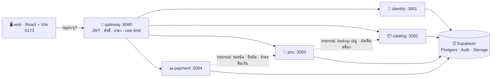

# 📄 รายงานโปรเจกต์ — POS & CRM ระบบขายหน้าร้าน 3 สาขา (เฟส 1)

> รายวิชา **CSI400 – เว็บเซอร์วิส** · Repository [noinahjajah/Pos_Crm](https://github.com/noinahjajah/Pos_Crm)
> Prototype: [Figma](https://www.figma.com/proto/pWc3YWHYawV6L3Ykm57Ke5?node-id=3-2&starting-point-node-id=3%3A2) · ผลทดสอบ: [UAT.md](UAT.md) · [README](../README.md)

| รหัสนักศึกษา | ชื่อ-นามสกุล | รับผิดชอบ |
|---|---|---|
| 67167033 | เปมิกา เมฆลอย | Dev 1 · identity · gateway |
| 67133846 | วรัตถา เตนากุล | Dev 2 · catalog · payment · รายงาน |
| 67180663 | ภัทรพล ถ่อมดี | Dev 3 · pos (โต๊ะ ออร์เดอร์ ครัว อนุมัติ) |

ข้อมูลในรายงานนี้ตรวจจากโค้ดจริง (`main` commit `ef56d2b` + [PR #6](https://github.com/noinahjajah/Pos_Crm/pull/6)) และจากระบบที่รันด้วย Docker กับ Supabase จริง เมื่อ 23 พ.ย. 2569

---

## สารบัญ

1. [บทนำ](#1-บทนำ)
2. [ผู้ใช้และความต้องการ](#2-ผู้ใช้และความต้องการ)
3. [สถาปัตยกรรม](#3-สถาปัตยกรรม)
4. [ความปลอดภัย](#4-ความปลอดภัย)
5. [ฐานข้อมูล](#5-ฐานข้อมูล)
6. [หน้าเว็บ](#6-หน้าเว็บ)
7. [การติดตั้งและรันระบบ](#7-การติดตั้งและรันระบบ)
8. [การทดสอบ](#8-การทดสอบ)
9. [ปัญหาที่พบและข้อเสนอแนะ](#9-ปัญหาที่พบและข้อเสนอแนะ)
10. [สรุป](#10-สรุป)

---

## 1. บทนำ

### 1.1 ที่มา

ร้านที่มี 3 สาขา (ร้านอาหาร · ร้านเครื่องดื่ม · บาร์) จดออร์เดอร์ คิดเงิน และสรุปยอดแยกกันในแต่ละสาขา
เจ้าของจึงเห็นภาพรวมช้า ส่วนลดและการคืนเงินไม่มีหลักฐานว่าใครอนุมัติ และสต็อกไม่ตรงกับยอดขายจริง

### 1.2 วัตถุประสงค์

1. พนักงานเปิดโต๊ะ สั่งอาหาร ส่งเข้าครัว และคิดเงินได้ในเครื่องเดียว
2. แยกสิทธิ์ตามบทบาท (staff · manager · owner) และแยกข้อมูลตามสาขา
3. ส่วนลดและการคืนเงินต้องผ่านการอนุมัติ และเก็บประวัติที่ลบไม่ได้
4. ตัดสต็อกอัตโนมัติเมื่อสั่ง และปิดขายเมนูที่หมดเอง
5. เจ้าของดูยอดขาย รายจ่าย และกำไรทุกสาขาได้จากที่เดียว
6. ฝึกออกแบบเว็บเซอร์วิสแบบ microservices ที่ทุก request ผ่าน API Gateway

### 1.3 ขอบเขต

| อยู่ในเฟส 1 | ไม่อยู่ในเฟส 1 |
|---|---|
| ผู้ใช้ สิทธิ์ สาขา · โต๊ะและออร์เดอร์ · เมนู ตัวเลือก สต็อก · ชำระเงิน · อนุมัติส่วนลด/คืนเงิน · รายจ่ายและรายงาน | สมาชิกและแต้ม (เฟส 2) · คูปอง (เฟส 3) · เชื่อมธนาคารจริง (PromptPay เป็นแบบจำลอง) · แยกบิล |

---

## 2. ผู้ใช้และความต้องการ

| Role | ใคร | ขอบเขตข้อมูล | งานหลัก |
|---|---|---|---|
| `staff` | พนักงานหน้าร้าน (เสิร์ฟ + แคชเชียร์) | สาขาตัวเอง | เปิดโต๊ะ สั่งอาหาร คิดเงิน ขอส่วนลด/คืนเงิน เปิด/ปิดขายเมนู |
| `manager` | ผู้จัดการสาขา | สาขาตัวเอง | เมนู สต็อก อนุมัติคำขอ รายจ่าย รายงานสาขา |
| `owner` | เจ้าของร้าน | ทุกสาขา | ผู้ใช้ สาขา หมวดหมู่ คัดลอกเมนู เปรียบเทียบสาขา กำไร |

Requirement เฟส 1 มี 37 ข้อ แบ่ง 5 หมวด (รายละเอียดใน [`pos-crm-phase1-spec.md`](pos-crm-phase1-spec.md))

| หมวด | ข้อ |
|---|---|
| ผู้ใช้ สิทธิ์ และสาขา | 1.1 – 1.6 |
| โต๊ะและออร์เดอร์ | 1.7 – 1.13 |
| เมนู ตัวเลือก สต็อก | 1.14 – 1.22 |
| ชำระเงินและอนุมัติ | 1.23 – 1.31 |
| รายจ่ายและแดชบอร์ด | 1.32 – 1.37 |

---

## 3. สถาปัตยกรรม



| Service | Port | หน้าที่ | Schema |
|---|:---:|---|---|
| **gateway** | 8080 | จุดเข้าเดียว · ตรวจ JWT · ตารางสิทธิ์ · กำหนดสาขา · rate limit · proxy | — |
| **identity** | 3001 | login/refresh/logout · ผู้ใช้ · สาขา · role | `identity1` |
| **catalog** | 3002 | หมวดหมู่ · เมนู (อัปโหลดรูป) · กลุ่มตัวเลือก · สต็อก · คัดลอกเมนู | `catalog` |
| **pos** | 3003 | โต๊ะ · บิล · ตั๋วครัว · ย้าย/รวมโต๊ะ · คำขออนุมัติ (SSE realtime) | `pos` |
| **payment** | 3004 | รับเงินสด/PromptPay · คืนเงิน · รายจ่าย · รายงาน | `payment` |
| **web** | 5173 | หน้าเว็บทุก role (React 19 + Vite) | — |

**เทคโนโลยี:** Node.js · Express · Zod (ตรวจข้อมูลเข้า) · jose (ตรวจ JWT) · React 19 · Vite · Supabase (Postgres · Auth · Storage) · Docker Compose

### การตัดสินใจสำคัญ

| การตัดสินใจ | เหตุผล |
|---|---|
| แยก 4 service ตามโดเมน | แต่ละคนรับผิดชอบ service ของตัวเอง พัฒนาและ deploy แยกกันได้ |
| Gateway จุดเดียว + ตารางสิทธิ์ในไฟล์เดียว (`access.config.js`) | ตรวจสิทธิ์ที่เดียว ปฏิเสธไว้ก่อน (deny by default) route ที่ไม่อยู่ในตาราง = 403 แม้เป็น owner |
| แยก schema ตาม service ใน Supabase project เดียว | ประหยัด (free tier) แต่ข้อมูลยังแยกกัน ข้ามกันผ่าน internal API เท่านั้น |
| งานที่ต้องทำหลายตารางพร้อมกันอยู่ในฟังก์ชันฐานข้อมูล | เปิดบิล เพิ่มตั๋ว ตัดสต็อก ทำใน transaction เดียว กันข้อมูลครึ่งๆ กลางๆ |
| Snapshot ชื่อและราคาตอนสั่ง | แก้เมนูทีหลังแล้วบิลเก่าไม่เปลี่ยน |
| `Idempotency-Key` ตอนสั่งอาหารและรับเงิน | เน็ตหลุดแล้วกดซ้ำ ไม่สั่งซ้ำ ไม่ตัดสต็อกซ้ำ ไม่รับเงินซ้ำ |
| คืนเงินตามสัดส่วน | ยอดคืนต่อรายการ = ราคารายการ × (ยอดสุทธิ ÷ ยอดก่อนส่วนลด) รวมผลของส่วนลดและ VAT แล้ว |

---

## 4. ความปลอดภัย

| ด้าน | วิธีที่ใช้ |
|---|---|
| **ยืนยันตัวตน** | Supabase Auth · gateway ตรวจลายเซ็น JWT ด้วย JWKS (RS256/ES256) หรือ secret (HS256) พร้อม issuer และ audience |
| **role และสาขา** | อ่านจาก claim ที่ custom access token hook ใส่ตอนออก token (มาจาก `identity1.profiles`) ไม่อ่านจาก `user_metadata` ที่ผู้ใช้แก้เองได้ |
| **แยกสาขา** | staff/manager ใช้สาขาจาก JWT เสมอ ไม่สน `branch_id` ที่ client ส่งมา · owner เลือกสาขาด้วย `?branch_id=` |
| **header ภายใน** | gateway ลบ header `X-User-*` `X-Branch-*` `X-Internal-*` ที่ client ส่งมาทิ้งก่อน แล้วใส่ของจริงเอง · service เชื่อ header เฉพาะเมื่อมี `X-Internal-Key` ที่ถูกต้อง |
| **service ภายใน** | identity/catalog/pos/payment เปิด port เฉพาะ `127.0.0.1` · `/internal/*` เรียกจากภายนอกไม่ได้ |
| **rate limit** | ทั่วไป 300 ครั้ง/นาที · login/refresh 10 ครั้ง/นาที/IP |
| **ข้อมูลเข้า** | ทุก endpoint ตรวจด้วย Zod ส่ง 400 พร้อมช่องที่ผิด |
| **ความลับ** | key อยู่ใน `.env` ของแต่ละ service ไม่ขึ้น git · `SUPABASE_SERVICE_ROLE_KEY` ใช้ฝั่ง server เท่านั้น |

---

## 5. ฐานข้อมูล

SQL อยู่ใน `supabase/migrations/` (4 ไฟล์ รันตามลำดับ) และมีชุดทดสอบใน `supabase/tests/`

| Schema | ตารางหลัก |
|---|---|
| `identity1` | `branches` · `roles` · `profiles` (+ `auth.users`) · custom access token hook |
| `catalog` | `categories` · `menus` · `option_groups` · `options` · `menu_option_groups` · `stocks` · `stock_movements` |
| `pos` | `dining_tables` · `orders` · `order_tables` · `kitchen_tickets` · `order_items` · `order_item_options` · `approvals` · `refund_items` |
| `payment` | `payments` · `expenses` |

**ข้อมูลตัวอย่างปัจจุบัน** (เพิ่มเมื่อ 23 พ.ย. 2569 รูปจาก TheMealDB / TheCocktailDB ซึ่งเป็นฐานข้อมูลรูปฟรี อัปโหลดเก็บใน Supabase Storage ของทีม)

| สาขา | เมนู | หมวด | กลุ่มตัวเลือก | โต๊ะ | พนักงาน |
|---|:---:|---|---|:---:|:---:|
| ร้านอาหาร สาขา 1 (R01) | 26 | อาหารจานเดียว · อาหาร หลายจาน | เลือกเนื้อสัตว์ · เพิ่มไข่ · ปริมาณ · ข้าว · ความเผ็ด · ความหวาน | 14 | manager 1 · staff 3 |
| ร้านเครื่องดื่ม สาขา 1 (D01) | 25 | เครื่องดื่ม · Mocktail (ไม่มีแอลกอฮอล์ทั้งหมด) | ขนาด · ระดับน้ำแข็ง · ท็อปปิ้ง · ชนิดนม · ความหวาน | 13 | manager 1 · staff 3 |
| บาร์ สาขา 1 (B01) | 26 | ค็อกเทล · Mocktail · เครื่องดื่ม | ระดับแอลกอฮอล์ · น้ำแข็ง · ตกแต่งแก้ว · ขนาดแก้ว · ขนาดน้ำ | 13 | manager 1 · staff 3 |

โต๊ะแบ่งโซน "ในร้าน" (A1–A6) และ "ด้านนอก" (B1–B4) เพิ่มจากโต๊ะเดิม T1–T4 · ทุกเมนูมีคำอธิบายและผูกกลุ่มตัวเลือกแล้ว

---

## 6. หน้าเว็บ

| Role | หน้า | สถานะ |
|---|---|:---:|
| ทุก role | เข้าสู่ระบบ · หน้าแรกตาม role | ✅ |
| staff · manager | ผังโต๊ะ · หน้าบิล (สั่งอาหาร · ย้าย/รวมโต๊ะ · ขอส่วนลด) · คิดเงิน · รับเงิน · เปิด/ปิดขายเมนู | ✅ |
| staff · manager | จอครัว (`/kitchen`) | 🧩 มี `KitchenPage.jsx` แล้ว ยังปิดใน router (API พร้อม) |
| staff | ขอคืนเงิน | ✅ |
| manager · owner | คำขออนุมัติ (realtime) · จัดการเมนู · กลุ่มตัวเลือก · สต็อก · ผู้ใช้ · รายจ่าย · ประวัติรับเงิน · รายงาน | ✅ |
| owner | หมวดหมู่ (เพิ่ม · แก้ · ปิดใช้ · ลบเมื่อไม่มีเมนู) · กำไรรายเดือน · จัดการสาขา | ✅ |

หน้าเว็บตรวจ role ก่อนแสดงทุกหน้า (`RequireRole`) และเมนูด้านซ้ายแสดงเฉพาะหน้าที่ role นั้นใช้ได้
เช่น staff เห็นแค่ ผังโต๊ะ · จอครัว · คิดเงิน · ขอคืนเงิน · เปิด/ปิดขายเมนู

---

## 7. การติดตั้งและรันระบบ

1. คัดลอก `.env.example` เป็น `.env` ในทุก service (`identity` `gateway` `catalog` `pos` `payment`) แล้วใส่ `SUPABASE_URL`, `SUPABASE_SERVICE_ROLE_KEY` และ `INTERNAL_KEY` (ค่าเดียวกันทุก service)
2. รัน SQL ใน `supabase/migrations/` ตามลำดับ และเปิด Exposed schemas: `identity1` `catalog` `pos` `payment`
3. รันด้วย Docker

```bash
docker compose -f docker-compose.yml -f docker-compose.dev.yml up -d --build   # โหมดพัฒนา
docker compose ps                                                               # ทุก service ต้อง healthy
curl http://localhost:8080/health                                               # {"status":"ok", ...}
```

เปิดเว็บที่ `http://localhost:5173`

---

## 8. การทดสอบ

| ระดับ | สิ่งที่มี | ผล |
|---|---|:---:|
| ตรวจข้อมูลเข้า | Zod ทุก endpoint | ✅ |
| Health check | `GET /health` ทุก service · Docker healthcheck | ✅ ทุก service healthy |
| Unit / Integration | `npm test` ทุก service: catalog 21 · gateway 38 · identity 17 · payment 51 · pos 28 · SQL test ใน `supabase/tests` | ✅ 155 / 155 |
| CI | GitHub Actions (`.github/workflows/test.yml`) รัน test ทุก service ทุก Pull Request และทุก push เข้า `main` | ✅ |
| **UAT** | 49 เคสครบ requirement `1.1 – 1.37` ทดสอบกับระบบจริงด้วยบัญชีจริงทั้ง 3 role (23 พ.ย. 2569 11:05–11:07 น. บน `main` + PR #6) | **ผ่าน 48 · ผ่านบางส่วน 1 · ไม่ผ่าน 0** |

ผล UAT รายเคสอยู่ใน [`UAT.md`](UAT.md)

| หมวด | เคส | ผ่าน |
|---|:---:|:---:|
| ผู้ใช้ สิทธิ์ และสาขา | 10 | 10 |
| โต๊ะและออร์เดอร์ | 9 | 8 (+1 บางส่วน) |
| เมนู ตัวเลือก สต็อก | 11 | 11 |
| ชำระเงินและอนุมัติ | 12 | 12 |
| รายจ่ายและแดชบอร์ด | 7 | 7 |

**ตัวอย่างผลที่ตรวจได้จริง**
- VAT: บิล 200 บาท → VAT 14.00 → สุทธิ 214.00 · รับเงินสด 500 → ทอน 286.00
- ส่วนลดหักก่อนคิด VAT: 285 − 28.50 + VAT 17.96 = 274.46
- สต็อก 5 → 3 ทันทีหลังสั่ง 2 จาน · เหลือ 0 ปิดขายเอง · เติมแล้วต้องกดเปิดขายเอง
- คำขอส่วนลดถึงผู้จัดการทันทีผ่าน SSE · คำขอลบไม่ได้ (403)
- กำไรรายเดือน = (รับเงิน − คืนเงิน) − รายจ่าย ตรงกับรายการจริง

---

## 9. ปัญหาที่พบและข้อเสนอแนะ

| ปัญหา | ผลกระทบ | ข้อเสนอแนะ |
|---|---|---|
| หน้าเว็บจอครัวยังปิดใช้งาน | ครัวต้องดูใบพิมพ์ ยังดูบนจอไม่ได้ (UAT-16 ผ่านบางส่วน) | Dev 3 เปิดคอมเมนต์ `/kitchen` ใน `router.jsx` และ `navItems.js` แล้วทดสอบ UAT-16 ซ้ำ |
| Schema ชื่อ `identity1` แต่ spec เขียน `identity` | เอกสารกับระบบไม่ตรงกัน | ทีมตกลงใช้ `identity1` · README และรายงานแก้แล้ว เหลือแก้ใน spec |
| รายงานเปรียบเทียบสาขารวมสาขาที่ปิดใช้งานแล้ว | ถ้ามีสาขาปิดใช้งาน ตัวเลขจะปน (ตอนนี้ลบสาขาทดสอบแล้ว) | กรองเฉพาะสาขาที่ `is_active` |
| ข้อมูลทดสอบ UAT อยู่ในฐานข้อมูลเดียวกับข้อมูลจริง | คำขออนุมัติลบผ่าน API ไม่ได้ตามกติกา ต้องลบด้วย SQL (ลบเรียบร้อยแล้ว 23 พ.ย.) | แยก Supabase project สำหรับทดสอบในอนาคต |
| PromptPay เป็นแบบจำลอง | ยังรับเงินโอนจริงไม่ได้ | เชื่อม payment gateway จริงในเฟสถัดไป |

---

## 10. สรุป

ระบบ POS & CRM เฟส 1 ออกแบบเป็น microservices 4 ตัว ทุก request ผ่าน API Gateway ที่ตรวจสิทธิ์แบบปฏิเสธไว้ก่อน และแยกข้อมูลตามสาขา
รันได้จริงด้วย Docker กับ Supabase และผ่าน UAT 48 จาก 49 เคส โดยไม่มีเคสที่ไม่ผ่าน
มี test อัตโนมัติ 155 ข้อรันทุก Pull Request · งานที่เหลือของเฟส 1 คือเปิดใช้หน้าจอครัว แล้วทดสอบ UAT-16 ซ้ำ แล้วต่อยอดเป็นระบบสมาชิกในเฟส 2
