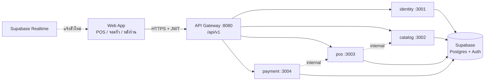
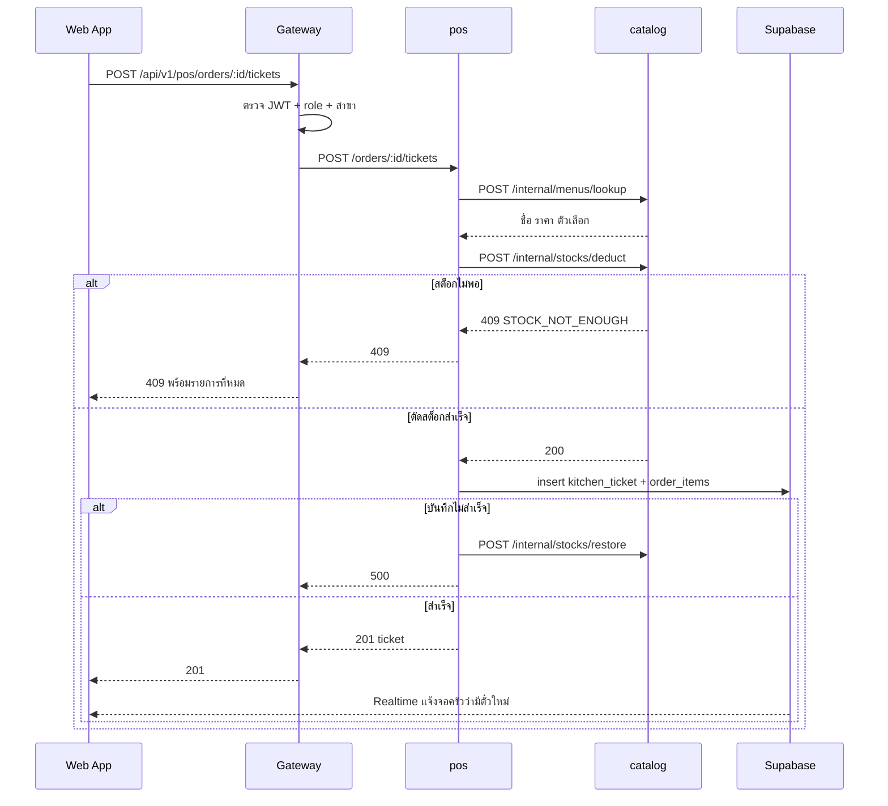
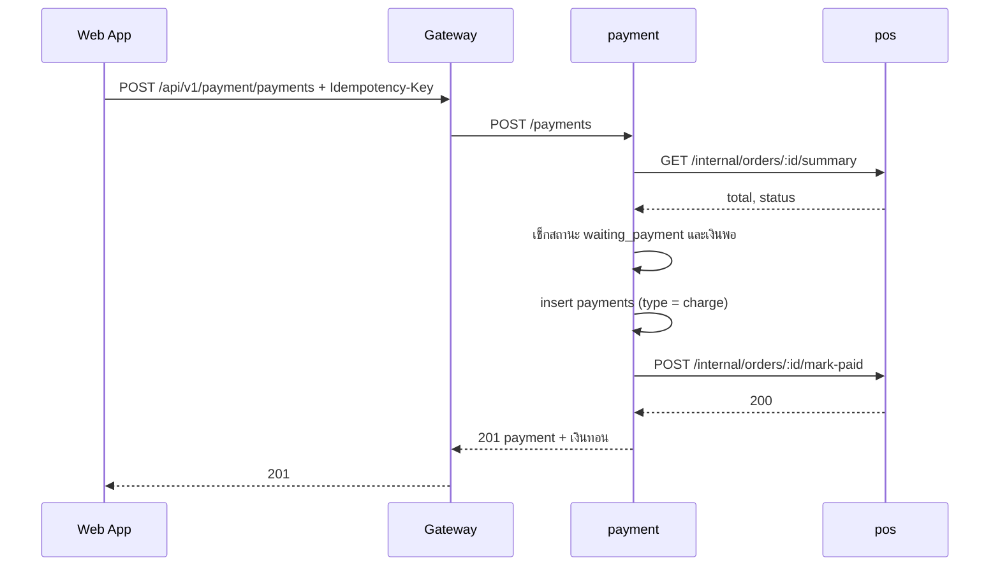

# API Gateway — เฟส 1

ครอบคลุม 4 service ของเฟส 1: identity, catalog, pos, payment
สมมติว่าใช้ Node.js ทุกตัว ถ้าใช้ภาษาอื่น โครงสร้างและเส้นทางยังเหมือนเดิม

---

## 1. ภาพรวมสถาปัตยกรรม



- client คุยกับ gateway ที่เดียว ส่วน service ทั้ง 4 ตัวอยู่ใน network ภายใน (เช่น docker network) และไม่เปิด port ออกนอก
- เส้นประ `internal` คือ service เรียกกันเองตรง ๆ ไม่ผ่าน gateway
- จอครัวรับแจ้งเตือนตั๋วใหม่จาก Supabase Realtime เป็นข้อยกเว้นข้อเดียว (ดูข้อ 7)

---

## 2. หน้าที่ของ Gateway (middleware เรียงตามลำดับ)

| ลำดับ | Middleware | ทำอะไร |
|---|---|---|
| 1 | Request ID | สร้าง `X-Request-Id` ถ้า client ไม่ได้ส่งมา ใช้ไล่ log ข้าม service |
| 2 | CORS | อนุญาตเฉพาะโดเมนของเว็บแอป |
| 3 | Rate limit | ทั่วไป 300 req/นาที/IP, `/auth/login` 10 req/นาที/IP |
| 4 | Auth | ตรวจ JWT ของ Supabase ยกเว้นเส้นทาง public |
| 5 | Route guard | เช็ก role กับตารางสิทธิ์ (ข้อ 4) ไม่ผ่านตอบ 403 |
| 6 | Branch scope | กำหนดสาขาที่ request นี้ทำงานได้ (ข้อ 3) |
| 7 | Block internal | path ที่ขึ้นต้นด้วย `/internal` ตอบ 404 เสมอ |
| 8 | Proxy | ตัด prefix แล้วส่งต่อไปยัง service, timeout 10 วินาที |
| 9 | Error format | service ล่มหรือ timeout แปลงเป็น 502/504 ในรูปแบบ error มาตรฐาน |
| 10 | Logging | method, path, status, เวลา, user_id, request_id |

### การตรวจ JWT
- client login ผ่าน `POST /api/v1/identity/auth/login` แล้วได้ `access_token` ของ Supabase กลับไป
- gateway ตรวจลายเซ็นด้วย JWKS ของ project (`https://<project>.supabase.co/auth/v1/.well-known/jwks.json`) ถ้า project ยังใช้ JWT secret แบบเก่าก็ตรวจด้วย secret แทน
- claim ที่ใช้: `sub` (= profiles.id), `user_role`, `branch_id` ซึ่งใส่ด้วย custom access token hook

### Header ที่ gateway ส่งต่อให้ service

| Header | ค่า |
|---|---|
| `X-Request-Id` | id ของ request |
| `X-User-Id` | `sub` จาก JWT |
| `X-User-Role` | waiter / cashier / manager / owner |
| `X-Branch-Id` | สาขาที่ทำงานได้ (ว่าง = owner ดูทุกสาขา) |
| `X-Internal-Key` | key ลับระหว่าง gateway กับ service |

service เชื่อ header เหล่านี้เฉพาะเมื่อ `X-Internal-Key` ถูกต้อง และ gateway จะลบ header ชื่อเดียวกันที่ client ส่งมาทิ้งก่อนเสมอ เพื่อไม่ให้ปลอมเป็น owner ได้

---

## 3. กติกาเรื่องสาขา (branch scope)

- **waiter, cashier, manager**: gateway ใส่ `X-Branch-Id` จาก JWT เสมอ และไม่สนใจ `branch_id` ที่ client ส่งมา
- **owner**: ส่ง `?branch_id=` มาเพื่อดูสาขาเดียวได้ ถ้าไม่ส่งจะได้ข้อมูลทุกสาขา
- service ทุกตัวต้องกรองข้อมูลด้วย `X-Branch-Id` เมื่อมีค่า

---

## 4. เส้นทางและสิทธิ์

gateway ตัด prefix `/api/v1/<service>` ออกก่อนส่งต่อ เช่น `/api/v1/pos/orders` ไปถึง pos service เป็น `/orders`

| Prefix | Service |
|---|---|
| `/api/v1/identity/*` | identity :3001 |
| `/api/v1/catalog/*` | catalog :3002 |
| `/api/v1/pos/*` | pos :3003 |
| `/api/v1/payment/*` | payment :3004 |

ตัวย่อ role: **W** = waiter, **C** = cashier, **M** = manager, **O** = owner, **public** = ไม่ต้อง login

### identity

| Method | Path | Role | คำอธิบาย |
|---|---|---|---|
| POST | `/auth/login` | public | username + password ได้ access/refresh token |
| POST | `/auth/refresh` | public | ขอ access token ใหม่ |
| POST | `/auth/logout` | W C M O | ออกจากระบบ |
| GET | `/me` | W C M O | ข้อมูลตัวเอง role และสาขา |
| GET | `/branches` | W C M O | รายชื่อสาขา |
| POST | `/branches` | O | เพิ่มสาขา |
| PATCH | `/branches/:id` | O | แก้ไขหรือปิดสาขา |
| GET | `/roles` | M O | รายชื่อ role |
| GET | `/users` | M O | พนักงาน (manager เห็นเฉพาะสาขาตัวเอง) |
| POST | `/users` | M O | เพิ่มพนักงาน (manager เพิ่มได้แค่ W, C ในสาขาตัวเอง) |
| PATCH | `/users/:id` | M O | แก้ไข เปลี่ยน role หรือปิดบัญชี |

### catalog

| Method | Path | Role | คำอธิบาย |
|---|---|---|---|
| GET | `/categories` | W C M O | หมวดหมู่ |
| POST | `/categories` | O | เพิ่มหมวดหมู่ |
| PATCH | `/categories/:id` | O | แก้ไขหมวดหมู่ |
| GET | `/menus` | W C M O | เมนูพร้อมสถานะพร้อมขายของสาขา (`?category_id=`) |
| GET | `/menus/:id` | W C M O | รายละเอียดเมนูพร้อมกลุ่มตัวเลือก |
| POST | `/menus` | O | เพิ่มเมนู |
| PATCH | `/menus/:id` | O | แก้ไขเมนูและราคา |
| DELETE | `/menus/:id` | O | soft delete (`is_deleted = true`) |
| PUT | `/menus/:id/option-groups` | O | กำหนดกลุ่มตัวเลือกของเมนู |
| GET | `/option-groups` | W C M O | กลุ่มตัวเลือกพร้อม options |
| POST | `/option-groups` | O | เพิ่มกลุ่มตัวเลือก |
| PATCH | `/option-groups/:id` | O | แก้ไขกลุ่มตัวเลือก |
| POST | `/option-groups/:id/options` | O | เพิ่มตัวเลือก |
| PATCH | `/options/:id` | O | แก้ไขตัวเลือก |
| GET | `/stocks` | M O | สต็อกของสาขา |
| PATCH | `/stocks/:menuId` | M O | ปรับจำนวนหรือเปิด/ปิดขาย |

### pos

| Method | Path | Role | คำอธิบาย |
|---|---|---|---|
| GET | `/tables` | W C M O | โต๊ะของสาขาพร้อมสถานะ |
| POST | `/tables` | M O | เพิ่มโต๊ะ |
| PATCH | `/tables/:id` | M O | แก้ไขโต๊ะ |
| POST | `/orders` | W C M | เปิดบิล `{table_ids, guest_count}` |
| GET | `/orders` | W C M O | รายการบิล (`?status=&date=`) |
| GET | `/orders/:id` | W C M O | บิลเต็ม: โต๊ะ ตั๋ว รายการ ยอดเงิน |
| POST | `/orders/:id/tables/move` | W C M | ย้ายโต๊ะ `{from_table_id, to_table_id}` |
| POST | `/orders/:id/tables/merge` | W C M | รวมโต๊ะ `{table_ids}` |
| POST | `/orders/:id/tickets` | W C M | สั่งอาหาร 1 รอบ `{items:[{menu_id, quantity, note, option_ids}]}` |
| POST | `/orders/:id/request-payment` | W C M | เรียกเก็บเงิน เปลี่ยนเป็น `waiting_payment` |
| GET | `/kitchen/tickets` | W M | ตั๋วครัวของสาขา (`?status=`) |
| PATCH | `/kitchen/tickets/:id` | W M | เปลี่ยนสถานะ `preparing` / `served` |
| POST | `/orders/:id/approvals` | C | ขอส่วนลดหรือคืนเงิน `{type, value_type, value, reason, refund_items?}` |
| GET | `/approvals` | M O | คำขอที่รออนุมัติ (`?status=pending`) |
| POST | `/approvals/:id/approve` | M O | อนุมัติ |
| POST | `/approvals/:id/reject` | M O | ปฏิเสธ |

### payment

| Method | Path | Role | คำอธิบาย |
|---|---|---|---|
| POST | `/payments` | C M | รับเงิน `{order_id, method, cash_received}` ต้องส่ง header `Idempotency-Key` |
| POST | `/payments/promptpay-qr` | C M | สร้าง QR PromptPay ตามยอดบิล `{order_id}` |
| POST | `/refunds` | C M | คืนเงินหลังได้รับอนุมัติ `{approval_id, method}` |
| GET | `/payments` | M O | รายการรับ/คืนเงิน (`?date=`) |
| GET | `/expenses` | M O | รายจ่าย (`?from=&to=`) |
| POST | `/expenses` | M O | บันทึกรายจ่าย |
| PATCH | `/expenses/:id` | M O | แก้ไขรายจ่าย |
| DELETE | `/expenses/:id` | M O | ลบรายจ่าย |
| GET | `/reports/daily` | M O | สรุปรายวัน: ยอดขาย ยอดคืน รายจ่าย (`?date=`) |

---

## 5. Internal API (service เรียกกันเอง ไม่ผ่าน gateway)

ทุกตัวต้องส่ง `X-Internal-Key` และ gateway บล็อก `/internal/*` จากภายนอกเสมอ

| เรียกจาก | ไปยัง | Endpoint | ใช้ตอนไหน |
|---|---|---|---|
| pos | catalog | `POST /internal/menus/lookup` | ดึงชื่อและราคาเมนูกับตัวเลือก ไปเก็บเป็น snapshot |
| pos | catalog | `POST /internal/stocks/deduct` | ตัดสต็อกตอนสั่ง |
| pos | catalog | `POST /internal/stocks/restore` | คืนสต็อกเมื่อสั่งไม่สำเร็จหรือคืนเงิน |
| payment | pos | `GET /internal/orders/:id/summary` | ดูยอดที่ต้องจ่ายและสถานะบิล |
| payment | pos | `POST /internal/orders/:id/mark-paid` | ปิดบิลหลังรับเงิน (เรียกซ้ำได้ ผลเหมือนเดิม) |
| payment | pos | `POST /internal/orders/:id/mark-refunded` | อัปเดตสถานะหลังคืนเงิน |

---

## 6. Flow สำคัญ

### สั่งอาหาร 1 รอบ



### รับเงิน



ถ้า pos ไม่ตอบตอน `mark-paid` ข้อมูลการรับเงินบันทึกไว้แล้ว ให้ payment ลองเรียกซ้ำ ซึ่งปลอดภัยเพราะ `mark-paid` ใช้ `order_id` กันการทำซ้ำ

---

## 7. จอครัวแบบ realtime

- จอครัว (login ด้วยบัญชี waiter หรือ manager ของสาขา) subscribe Supabase Realtime ที่ตาราง `pos.kitchen_tickets` ด้วย JWT ของผู้ใช้
- ใส่ RLS ให้ select ได้เฉพาะแถวที่ `branch_id` ตรงกับ claim ใน JWT
- Realtime ใช้แค่แจ้งว่ามีตั๋วใหม่ จากนั้นจอครัวเรียก `GET /api/v1/pos/kitchen/tickets` ผ่าน gateway เพื่อดึงรายละเอียด
- ถ้าไม่อยากเปิด schema `pos` ให้ client เห็น ให้ใช้ SSE ผ่าน gateway แทน (`GET /api/v1/pos/kitchen/stream`)

---

## 8. รูปแบบ response

สำเร็จ

```json
{ "data": { }, "meta": { "page": 1, "total": 42 } }
```

ผิดพลาด

```json
{
  "error": { "code": "STOCK_NOT_ENOUGH", "message": "เมนูบางรายการหมด", "details": [ ] },
  "request_id": "b1f2..."
}
```

| HTTP | ใช้เมื่อ |
|---|---|
| 400 | ข้อมูลไม่ถูกต้อง (`VALIDATION_ERROR`) |
| 401 | ไม่ได้ login หรือ token หมดอายุ |
| 403 | role หรือสาขาไม่มีสิทธิ์ |
| 404 | ไม่พบข้อมูล |
| 409 | สถานะไม่ถูกต้อง เช่น สต็อกไม่พอ บิลจ่ายแล้ว |
| 429 | เรียกถี่เกินไป |
| 502 / 504 | service ปลายทางล่มหรือตอบช้าเกิน |

---

## 9. เทคโนโลยีที่แนะนำ

| ส่วน | ตัวเลือก |
|---|---|
| Gateway | Node.js + Express |
| Proxy | `http-proxy-middleware` |
| ตรวจ JWT | `jose` (รองรับ JWKS) |
| Rate limit | `express-rate-limit` |
| Validation (ใน service) | `zod` |
| รัน | Docker Compose: เปิดแค่ gateway port 8080 ออกนอก |
| Health check | `GET /health` ของ gateway รวมสถานะของทั้ง 4 service |

### config เส้นทาง (ตัวอย่าง)

```js
const routes = [
  { prefix: '/api/v1/identity', target: 'http://identity:3001', public: ['/auth/login', '/auth/refresh'] },
  { prefix: '/api/v1/catalog',  target: 'http://catalog:3002' },
  { prefix: '/api/v1/pos',      target: 'http://pos:3003' },
  { prefix: '/api/v1/payment',  target: 'http://payment:3004' },
];
```

ตารางสิทธิ์ในข้อ 4 เขียนเป็น config แบบ `{ method, path, roles }` ให้ route guard อ่าน จะได้แก้สิทธิ์ที่เดียว
