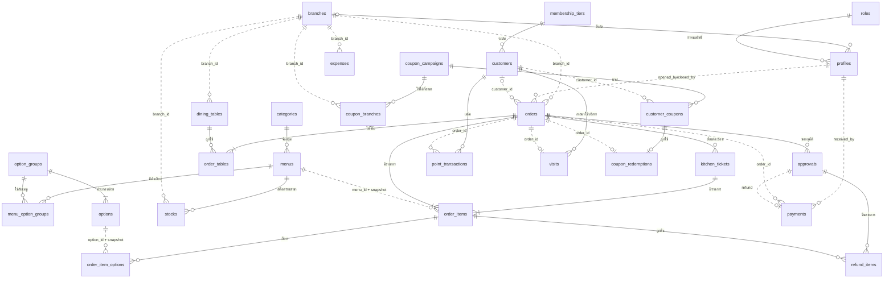
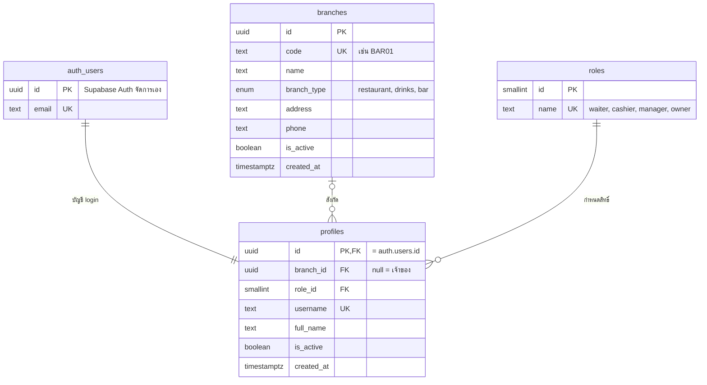
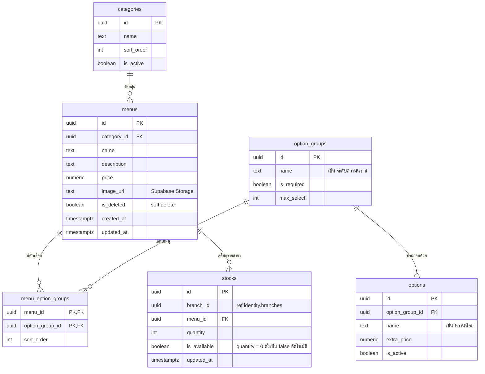
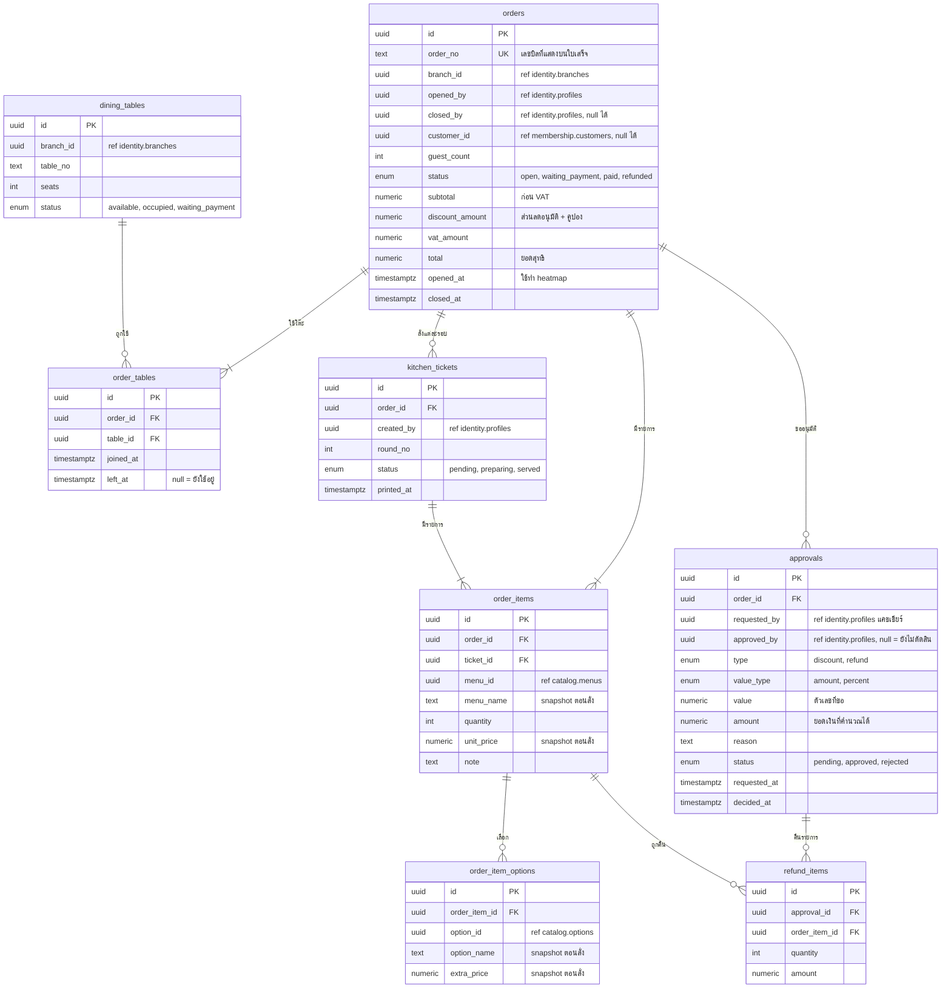
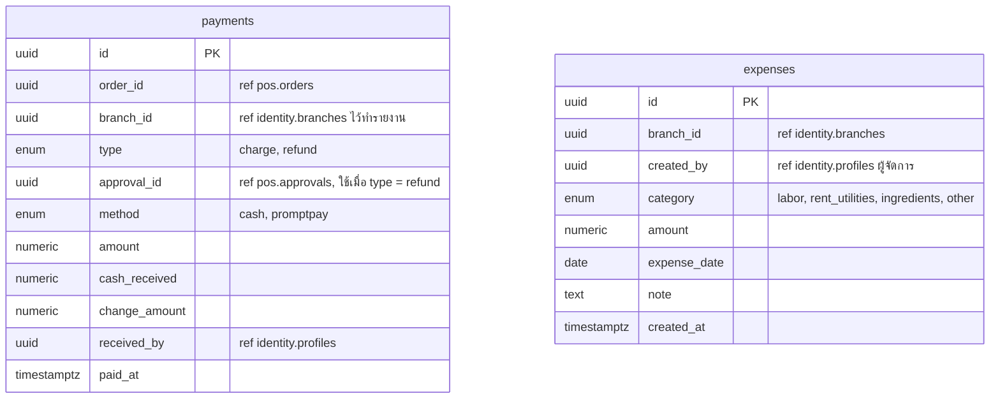
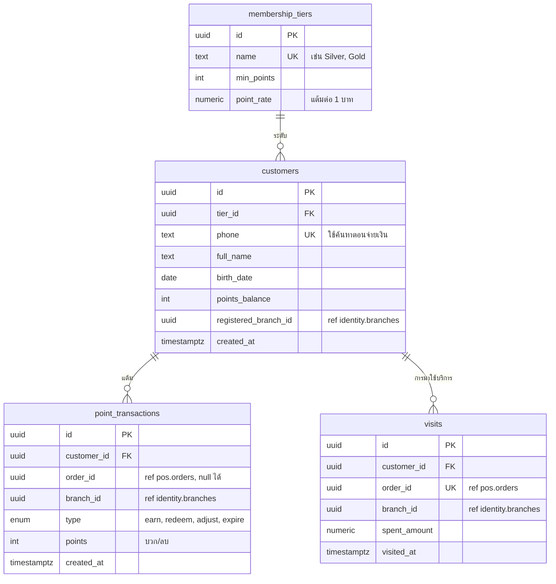
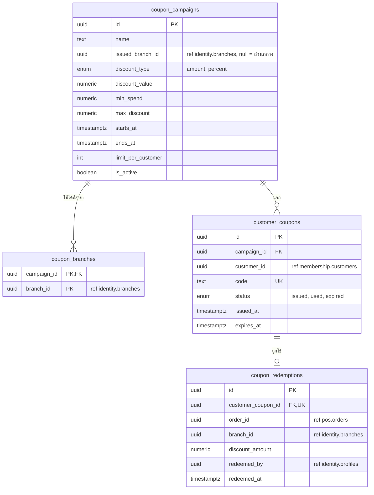

# ER Diagram ราย Service — POS CRM

Supabase 1 project แบ่ง schema ตาม service: `identity`, `catalog`, `pos`, `payment`, `membership`, `coupon`

- PK เป็น `uuid` ทุกตาราง (`default gen_random_uuid()`) ยกเว้น `roles` ที่ใช้ `smallint`
- `FK` = foreign key จริงภายใน schema เดียวกัน
- ฟิลด์ที่มีหมายเหตุ `ref <schema>.<table>` = อ้างข้าม service: เก็บแค่ id ไม่ผูก FK
- enum ทำเป็น Postgres enum หรือ `text` + `check` ก็ได้
- เส้นทึบ `--` = FK จริง, เส้นประ `..` = อ้างข้าม service (ในภาพรวม)

---

## ภาพรวม (แสดงเฉพาะความสัมพันธ์)

---

## identity (เฟส 1)

`auth.users` เป็นตารางของ Supabase Auth ไม่ต้องสร้างเอง และไม่ต้องเก็บ `password_hash`
ถ้าอยากให้พนักงาน login ด้วย username ให้แปลงเป็นอีเมล เช่น `somchai@pos.local`

- `role` และ `branch_id` ใส่ลง JWT ด้วย custom access token hook แล้ว API Gateway เป็นคนตรวจ token และส่งต่อให้ service เป็น header

---

## catalog (เฟส 1)

เมนูเป็นชุดกลางที่ทุกสาขาใช้ร่วมกัน ส่วนสต็อกและสถานะเปิด/ปิดขายแยกตามสาขา

- `stocks` มี unique (`branch_id`, `menu_id`)
- ตัดสต็อกผ่าน API ของ catalog เท่านั้น เช่น `POST /stocks/deduct` และควรมี `POST /stocks/restore` ไว้คืนสต็อกเมื่อสั่งไม่สำเร็จ

---

## pos (เฟส 1)

- `kitchen_tickets` เปิด Supabase Realtime ให้จอครัวรับตั๋วใหม่ได้ทันที
- คืนเงินทั้งบิล: ไม่มี `refund_items` และ `amount` เท่ากับ `orders.total`
- คืนเงินบางรายการ: มี `refund_items` ระบุรายการและจำนวน

---

## payment (เฟส 1)

- ไม่มี FK ภายใน service นี้ ทุกฟิลด์อ้างข้าม service
- `payments` เก็บ `branch_id` ซ้ำไว้ จะได้ทำรายงานรายรับรายจ่ายรายสาขาโดยไม่ต้องเรียก pos
- เมื่อรับเงินครบ payment เรียก pos ให้เปลี่ยน `orders.status = paid` โดยใช้ `order_id` กันการเรียกซ้ำ

---

## membership (เฟส 2)

- `visits` บันทึกเมื่อบิลของสมาชิกถูกปิด ทำให้ membership วิเคราะห์พฤติกรรมลูกค้าได้เองโดยไม่ต้องอ่าน DB ของ pos
- heatmap ช่วงเวลาคนเยอะของทุกบิล (รวมลูกค้าที่ไม่ใช่สมาชิก) ยังใช้ `pos.orders.opened_at`

---

## coupon (เฟส 3)

คูปองที่ออกจากสาขาหนึ่งใช้ที่สาขาอื่นได้ โดยกำหนดสาขาที่ใช้ได้ใน `coupon_branches`

---

## สรุปจำนวนตาราง

| Service | ตาราง | เฟส |
|---|---|---|
| identity | 3 (+ auth.users ของ Supabase) | 1 |
| catalog | 6 | 1 |
| pos | 8 | 1 |
| payment | 2 | 1 |
| membership | 4 | 2 |
| coupon | 4 | 3 |
| **รวม** | **27** | |
