# POS CRM — เอกสารรวมเฟส 1 (Requirement + ERD + API Gateway + แบ่งงาน)

> รวมจาก `erd-services.md`, `api-gateway-phase1.md`, `phase1-work-split.md` และ requirement ฉบับล่าสุดที่ตกลงกันในแชท (อัปเดต 2026-11-17)
> ข้อ 1.x ในวงเล็บคืออ้างอิง requirement เฟส 1 · ตัวย่อ role: **S** = staff (พนักงานหน้าร้าน รวมหน้าที่ waiter + cashier), **M** = manager, **O** = owner

---

## 0. สรุปโปรเจกต์และการตัดสินใจที่ใช้อยู่ตอนนี้

- เว็บ POS (web only) สำหรับ 3 สาขา (restaurant / drinks / bar) พร้อม CRM แบ่ง 3 เฟส: **เฟส 1 POS → เฟส 2 สมาชิก/วิเคราะห์การมาใช้บริการ → เฟส 3 คูปองข้ามสาขา**
- สถาปัตยกรรม: microservice จริง (deploy แยก) · React (Vite) + Node.js (Express) · ฐานข้อมูล Supabase 1 project แยก schema ต่อ service
- เฟส 1 มี 4 service: `identity`, `catalog`, `pos`, `payment` (เฟส 2 = `membership`, เฟส 3 = `coupon`)
- role มี 3 ตัว: **staff** (พนักงานหน้าร้าน = waiter + cashier รวมกัน เพราะร้านใช้เครื่อง POS เครื่องเดียวและคนเดียวทำทั้งสองหน้าที่), **manager**, **owner** (manager/owner ใช้บัญชีของตัวเอง) — **ไม่มี role kitchen** (จอครัวใช้บัญชี staff หรือ manager ของสาขา)
- service คุยกันด้วย REST ตรง ไม่ใช้ message broker · ไม่ผูก FK ข้าม schema (เก็บแค่ id) · service ไม่เปิด port ออกนอก รับเฉพาะ request ที่มี `X-Internal-Key`
- gateway เป็นตัวตรวจ JWT ที่เดียว แล้วส่งต่อเป็น header `X-User-*`
- **ไม่รองรับแยกบิล** (1.13) · ชำระเงิน 2 วิธี: เงินสด (คิดเงินทอน) และ QR PromptPay จำลอง **กดยืนยันแล้วสำเร็จทันที** (1.25)
- **เมนูและกลุ่มตัวเลือกเป็นของแต่ละสาขา** (manager แก้ได้เฉพาะสาขาตัวเอง ไม่กระทบสาขาอื่น) ส่วน **หมวดหมู่เป็นของกลาง** จัดการโดย owner เท่านั้น
- สต็อก: เหลือ 0 → ปิดขายอัตโนมัติ แต่เติมจาก 0 แล้ว **ไม่เปิดขายให้** staff เปิดเอง · **คืนเงินไม่คืนสต็อก**

---

## 1. Requirement เฟส 1 ฉบับล่าสุด (สรุปจากที่ตกลงใน doc)

> หมายเหตุ: ข้อความนี้สรุปจากสิ่งที่ doc ทั้ง 3 ฉบับอ้างอิง ไม่ใช่ข้อความต้นฉบับของ requirement ถ้าต้นฉบับแก้ถ้อยคำ ให้ยึดต้นฉบับ

### ผู้ใช้ สิทธิ์ และสาขา (Dev 1)

| ข้อ | ข้อกำหนด (ฉบับล่าสุด) |
|---|---|
| 1.1 | **3 role: staff, manager, owner** · staff = พนักงานหน้าร้าน รวมหน้าที่ waiter + cashier (ร้านใช้เครื่อง POS เครื่องเดียว คนเดียวทำทั้งสองหน้าที่) · manager และ owner ใช้บัญชีของตัวเอง |
| 1.2 | login ด้วย username + password เมนูและสิทธิ์ตาม role · ไม่มีสิทธิ์ตอบ 403 |
| 1.3 | staff/manager เห็นและทำงานได้เฉพาะสาขาตัวเอง |
| 1.4 | owner เห็นได้ทุกสาขา และเลือกดูทีละสาขาได้ |
| 1.5 | **เพิ่ม/แก้ไข/ลบผู้ใช้ — เฉพาะ owner** (manager ดูรายชื่อพนักงานสาขาตัวเองได้อย่างเดียว) |
| 1.6 | **owner เพิ่ม/แก้ไข/ลบสาขา** |

### โต๊ะและออร์เดอร์ (Dev 3)

| ข้อ | ข้อกำหนด |
|---|---|
| 1.7 | เปิดโต๊ะ ระบุจำนวนลูกค้า บันทึกเวลาเปิด (`opened_at`) |
| 1.8 | โต๊ะมี 3 สถานะ: ว่าง / มีลูกค้า / รอชำระ |
| 1.9 | สั่งอาหารได้หลายรอบ ระบุจำนวน ตัวเลือก หมายเหตุ (เก็บ snapshot ชื่อ/ราคา) |
| 1.10 | พิมพ์ใบออร์เดอร์เข้าครัว (โต๊ะ เวลา รายการ ตัวเลือก หมายเหตุ) และใบเสร็จ — Dev 1 ทำ layout, Dev 3 ส่งข้อมูล |
| 1.11 | ย้ายโต๊ะ |
| 1.12 | รวมโต๊ะเป็นบิลเดียว |
| 1.13 | ไม่มีการแยกบิล |

### เมนู ตัวเลือก สต็อก (Dev 2)

| ข้อ | ข้อกำหนด |
|---|---|
| 1.14 | manager เพิ่ม/แก้ไข/ลบเมนูของ**สาขาตัวเอง** (ชื่อ หมวด ราคา รูป) · owner ทำได้ทุกสาขา (ส่ง `branch_id`) · **เมนูเป็นของแต่ละสาขา** แก้แล้วไม่กระทบสาขาอื่น · owner คัดลอกเมนูข้ามสาขาได้ · หมวดหมู่เป็นของกลาง จัดการโดย owner เท่านั้น |
| 1.15 | **staff, manager, owner** เปิด/ปิดขายเมนูได้ · หน้าร้านปิดเมนูที่ขายได้เมื่อของหมดหรือไม่พร้อม และเปิดกลับเองเมื่อพร้อมขาย (เปิดไม่ได้ถ้าสต็อก = 0) |
| 1.16 | กลุ่มตัวเลือกเสริมของสาขา กำหนด `max_select` (1 = เลือกอย่างเดียว, >1 = หลายอย่าง) — manager (สาขาตัวเอง) / owner |
| 1.17 | ตัวเลือกมีราคาบวกเพิ่ม (`extra_price`) — manager (สาขาตัวเอง) / owner |
| 1.18 | ผูกกลุ่มตัวเลือกกับเมนูทีละรายการ (1 กลุ่มใช้กับหลายเมนูได้ ภายในสาขาเดียวกัน) — manager (สาขาตัวเอง) / owner |
| 1.19 | สต็อกของเมนู (เมนูเป็นของสาขาอยู่แล้ว จึงเป็นสต็อกต่อสาขา) |
| 1.20 | สั่งอาหารแล้วตัดสต็อกอัตโนมัติ (atomic กัน race) |
| 1.21 | สต็อกเหลือ 0 → ปิดขายอัตโนมัติ |
| 1.22 | เติม/แก้สต็อกได้ (`{quantity}` ตั้งค่า หรือ `{add}` เติมเพิ่ม) · **จาก 0 → มากกว่า 0 ไม่เปิดขายให้อัตโนมัติ** staff เปิดเองเมื่อพร้อม (ของเข้าแล้วแต่อาจยังไม่ได้เตรียม) |

### ชำระเงินและอนุมัติ (Dev 2 ฝั่งเงิน / Dev 3 ฝั่งบิล)

| ข้อ | ข้อกำหนด |
|---|---|
| 1.23 | คิดเงินและออกใบเสร็จ (ก่อน VAT / VAT / สุทธิ) |
| 1.24 | `vat = (subtotal − discount) × 7%` · `total = subtotal − discount + vat` |
| 1.25 | เงินสด: คำนวณเงินทอนตามปกติ · QR PromptPay: **จำลอง กดยืนยันแล้วถือว่าชำระสำเร็จทันที** (ไม่ตรวจกับธนาคาร) |
| 1.26 | จ่ายแล้วโต๊ะทั้งหมดของบิลกลับเป็น "ว่าง" |
| 1.27 | staff ขอส่วนลด (บาท/เปอร์เซ็นต์) พร้อมเหตุผล |
| 1.28 | staff ขอคืนเงินได้เฉพาะบิลที่จ่ายแล้ว (ทั้งบิลหรือบางรายการ) · **คืนเงินไม่คืนสต็อก** |
| 1.29 | **แจ้ง manager/owner แบบ realtime บนเครื่องตัวเอง** · manager/owner อนุมัติหรือปฏิเสธ · staff ดูคำขอของตัวเองได้ |
| 1.30 | ส่วนลด/คืนเงินมีผลเฉพาะคำขอที่ `approved` |
| 1.31 | log ผู้ขอ ผู้อนุมัติ เวลา เหตุผลทุกคำขอ (ห้ามลบ) |

### รายจ่ายและแดชบอร์ด (Dev 2)

| ข้อ | ข้อกำหนด |
|---|---|
| 1.32 | manager บันทึกรายจ่ายของสาขาตัวเอง |
| 1.33 | รายจ่าย 4 หมวด: ค่าแรง, ค่าเช่า/ค่าไฟ/ค่าน้ำ, วัตถุดิบ, อื่นๆ |
| 1.34 | แดชบอร์ดรายวัน: ยอดขาย จำนวนบิล เฉลี่ยต่อบิล |
| 1.35 | เมนูขายดี |
| 1.36 | owner เปรียบเทียบยอดขายทุกสาขา |
| 1.37 | รายรับ − รายจ่าย = กำไร แยกสาขาแยกเดือน |

### สิ่งที่แก้จากฉบับก่อน

| เรื่อง | ก่อนแก้ | หลังแก้ |
|---|---|---|
| role | waiter และ cashier แยกกัน (4 role) | รวมเป็น `staff` (3 role) |
| 1.5 ผู้ใช้ | M O เพิ่มพนักงานได้ ไม่มีลบ | เพิ่ม/แก้/ลบ เฉพาะ O (manager ดูสาขาตัวเอง) |
| 1.6 สาขา | เพิ่ม/แก้ | เพิ่ม `DELETE /branches/:id` (soft delete) |
| 1.14, 1.16–1.18 เมนู/ตัวเลือก | ชุดกลางทุกสาขา (O) → ชุดกลาง M O | **เมนู/กลุ่มตัวเลือกเป็นของแต่ละสาขา** (`branch_id`) manager แก้เฉพาะสาขาตัวเอง · owner คัดลอกข้ามสาขาได้ |
| ราคาเมนู | ราคากลาง `menus.price` + ราคาสาขา `stocks.price` | อยู่ใน `menus.price` ของเมนูสาขา (เลิก `stocks.price` และ `/menus/:id/price`) |
| หมวดหมู่ | ไม่ระบุ | ของกลาง owner เท่านั้น |
| 1.15 เปิด/ปิดขาย | อยู่ใน `PATCH /stocks` (M O) | `PATCH /menus/:id/availability` S M O |
| 1.22 เติมสต็อก | แก้จำนวนอย่างเดียว → จาก 0 เปิดขายเอง | `{quantity}` / `{add}` และ **จาก 0 ไม่เปิดขายเอง** staff เปิดเอง |
| 1.25 PromptPay | สร้าง QR จำลองแล้วรอยืนยัน | กดยืนยันแล้วสำเร็จทันที (เลิก `/payments/promptpay-qr`) |
| 1.28 คืนเงิน | คืนสต็อกเมื่อคืนเงิน | **ไม่คืนสต็อก** |
| 1.29 แจ้งคำขอ | ไม่มีแจ้งเตือน | Realtime/SSE, staff ดูคำขอตัวเองได้ |
| 1.24 VAT | ไม่ระบุสูตร | `vat = (subtotal − discount) × 7%` |
| 1.34–1.37 แดชบอร์ด | มีแค่ `/reports/daily` | เพิ่ม bill_count, avg_per_bill, top_menus, `/reports/branches`, `/reports/profit` |
| RLS Realtime | `kitchen_tickets` ไม่มี `branch_id` | เพิ่ม `branch_id` ใน `kitchen_tickets` และ `approvals` |
| role kitchen | เคยเพิ่ม | เอาออก |

---

## 2. สถาปัตยกรรม

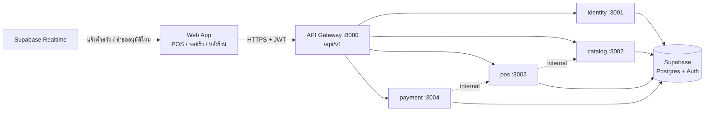

- client คุยกับ gateway ที่เดียว ส่วน service ทั้ง 4 ตัวอยู่ใน network ภายใน (docker network) ไม่เปิด port ออกนอก
- เส้นประ `internal` = service เรียกกันเองตรง ๆ ไม่ผ่าน gateway
- จอครัวและแจ้งเตือนคำขออนุมัติรับจาก Supabase Realtime เป็นข้อยกเว้นข้อเดียว (ดูข้อ 6)

### Gateway — middleware เรียงตามลำดับ

| ลำดับ | Middleware | ทำอะไร |
|---|---|---|
| 1 | Request ID | สร้าง `X-Request-Id` ถ้า client ไม่ส่งมา |
| 2 | CORS | อนุญาตเฉพาะโดเมนเว็บแอป |
| 3 | Rate limit | ทั่วไป 300 req/นาที/IP, `/auth/login` 10 req/นาที/IP |
| 4 | Auth | ตรวจ JWT ของ Supabase ยกเว้นเส้นทาง public (1.2) |
| 5 | Route guard | เช็ก role กับตารางสิทธิ์ ไม่ผ่านตอบ 403 (1.2) |
| 6 | Branch scope | กำหนดสาขาที่ request ทำงานได้ (1.3, 1.4) |
| 7 | Block internal | path ขึ้นต้น `/internal` ตอบ 404 เสมอ |
| 8 | Proxy | ตัด prefix ส่งต่อ timeout 10 วินาที |
| 9 | Error format | service ล่ม/timeout แปลงเป็น 502/504 รูปแบบมาตรฐาน |
| 10 | Logging | method, path, status, เวลา, user_id, request_id |

**ตรวจ JWT:** login ผ่าน `POST /api/v1/identity/auth/login` ได้ `access_token` ของ Supabase · gateway ตรวจด้วย JWKS (`https://<project>.supabase.co/auth/v1/.well-known/jwks.json`) หรือ JWT secret แบบเก่า · claim: `sub` (= profiles.id), `user_role`, `branch_id` (ใส่ด้วย custom access token hook)

**Header ที่ส่งต่อให้ service**

| Header | ค่า |
|---|---|
| `X-Request-Id` | id ของ request |
| `X-User-Id` | `sub` จาก JWT |
| `X-User-Role` | staff / manager / owner |
| `X-Branch-Id` | สาขาที่ทำงานได้ (ว่าง = owner ดูทุกสาขา) |
| `X-Internal-Key` | key ลับระหว่าง gateway กับ service |

service เชื่อ header เหล่านี้เฉพาะเมื่อ `X-Internal-Key` ถูก และ gateway ลบ header ชื่อเดียวกันที่ client ส่งมาก่อนเสมอ

### กติกาสาขา (branch scope) (1.3, 1.4)

- **S, M:** gateway ใส่ `X-Branch-Id` จาก JWT เสมอ ไม่สนใจ `branch_id` ที่ client ส่ง (query/body)
- **O:** ส่ง `?branch_id=` เพื่อดูสาขาเดียว ไม่ส่ง = ทุกสาขา
- **O สร้างข้อมูลที่ผูกสาขา** (โต๊ะ รายจ่าย เมนู กลุ่มตัวเลือก สต็อก) ต้องส่ง `branch_id` ใน body เพราะไม่มีสาขาประจำตัว
- service ทุกตัวกรองด้วย `X-Branch-Id` เมื่อมีค่า

---

## 3. ERD (Supabase 1 project แยก schema ตาม service)

- PK เป็น `uuid` (`gen_random_uuid()`) ทุกตาราง ยกเว้น `roles` ใช้ `smallint`
- ฟิลด์ `ref <schema>.<table>` = อ้างข้าม service เก็บแค่ id ไม่ผูก FK
- เส้นทึบ `--` = FK จริงใน schema เดียวกัน, เส้นประ `..` = อ้างข้าม service

### ภาพรวม

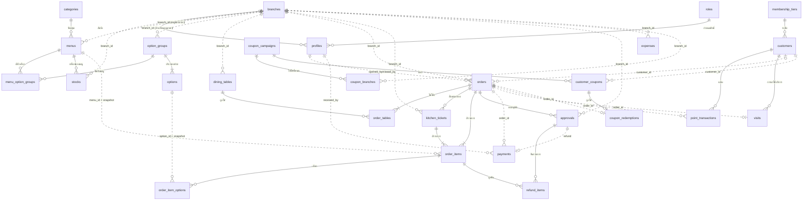

### identity (เฟส 1)

`auth.users` เป็นตารางของ Supabase Auth ไม่ต้องสร้างเองและไม่เก็บ `password_hash` · ถ้าให้ login ด้วย username ให้แปลงเป็นอีเมล เช่น `somchai@pos.local`

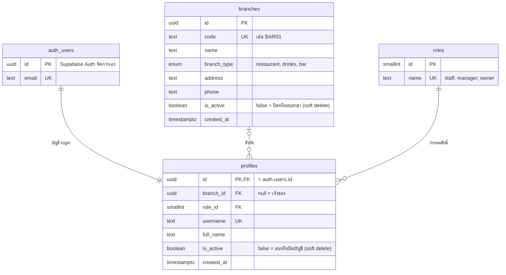

- `role` และ `branch_id` ใส่ลง JWT ด้วย custom access token hook · gateway ตรวจ token แล้วส่งต่อเป็น header
- เจ้าของเท่านั้นเพิ่ม/ลบ/แก้ผู้ใช้และสาขา (1.5, 1.6) ลบแบบ soft delete เพื่อไม่ให้ id ที่อ้างใน service อื่นหาย

### catalog (เฟส 1)

**เมนู ราคา กลุ่มตัวเลือก สต็อก สถานะเปิด/ปิดขาย = เป็นของแต่ละสาขา** (มี `branch_id`) · **`categories` = ของกลาง** owner จัดการเท่านั้น

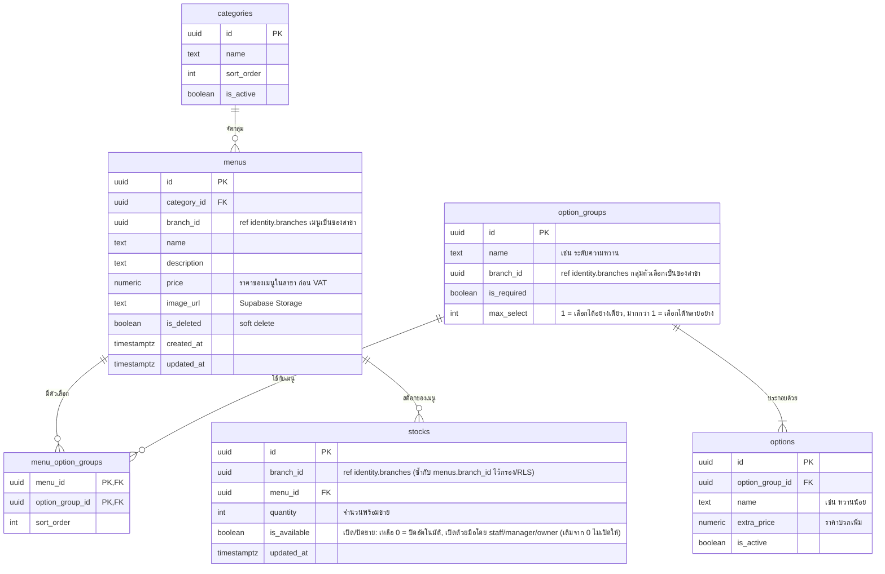

- `stocks` unique (`menu_id`) (เก็บ `branch_id` ซ้ำไว้ใช้กรองและ RLS) · เปิดขายด้วยมือไม่ได้เมื่อ `quantity = 0`
- **เมนูเป็นของแต่ละสาขา** (`menus.branch_id`): ชื่อ ราคา รูป ตัวเลือก อยู่ในเมนูของสาขานั้น manager แก้ได้เฉพาะสาขาตัวเอง ไม่กระทบสาขาอื่น · owner คัดลอกเมนูข้ามสาขาได้ผ่าน `POST /menus/:id/copy` (คัดลอกพร้อมกลุ่มตัวเลือก สต็อก 0 และปิดขาย; คัดลอกครั้งเดียว ไม่ตามกันภายหลัง) · `categories` เป็นของกลาง เพิ่ม/แก้โดย owner เท่านั้น
- ตัดสต็อกผ่าน internal API ของ catalog เท่านั้น (`/internal/stocks/deduct`, `/internal/stocks/restore`) · `restore` ใช้เฉพาะ rollback ตอนสั่งอาหารไม่สำเร็จ **คืนเงินไม่คืนสต็อก**
- สต็อกเหลือ 0 → catalog ตั้ง `is_available = false` ให้เอง (1.21) แต่จาก 0 → มากกว่า 0 **ไม่เปิดขายให้** staff เปิดเองผ่าน `/availability` (1.22)
- สร้างเมนูใหม่ → catalog สร้างแถว `stocks` ให้ทันที (`quantity = 0`, `is_available = false`)
- กลุ่มตัวเลือก 1 กลุ่มผูกกับหลายเมนูได้ผ่าน `menu_option_groups` แต่เมนูและกลุ่มต้องอยู่สาขาเดียวกัน (service ตรวจตอนผูก) (1.18)

### pos (เฟส 1)

```mermaid
erDiagram
  dining_tables ||--o{ order_tables : "ถูกใช้"
  orders ||--|{ order_tables : "ใช้โต๊ะ"
  orders ||--o{ kitchen_tickets : "สั่งแต่ละรอบ"
  kitchen_tickets ||--|{ order_items : "มีรายการ"
  orders ||--|{ order_items : "มีรายการ"
  order_items ||--o{ order_item_options : "เลือก"
  orders ||--o{ approvals : "ขออนุมัติ"
  approvals ||--o{ refund_items : "คืนรายการ"
  order_items ||--o{ refund_items : "ถูกคืน"

  dining_tables {
    uuid id PK
    uuid branch_id "ref identity.branches"
    text table_no
    int seats
    enum status "available=ว่าง, occupied=มีลูกค้า, waiting_payment=รอชำระ"
  }
  orders {
    uuid id PK
    text order_no UK "เลขบิลที่แสดงบนใบเสร็จ"
    uuid branch_id "ref identity.branches"
    uuid opened_by "ref identity.profiles"
    uuid closed_by "ref identity.profiles, null ได้"
    uuid customer_id "ref membership.customers, null ได้ (เฟส 2)"
    int guest_count "จำนวนลูกค้าตอนเปิดโต๊ะ"
    enum status "open, waiting_payment, paid, refunded"
    numeric subtotal "ก่อน VAT"
    numeric discount_amount "ส่วนลดที่อนุมัติแล้ว + คูปอง"
    numeric vat_amount "7% ของ (subtotal - discount_amount)"
    numeric total "ยอดสุทธิ"
    timestamptz opened_at "เวลาเปิดโต๊ะ ใช้ทำ heatmap"
    timestamptz closed_at
  }
  order_tables {
    uuid id PK
    uuid order_id FK
    uuid table_id FK
    timestamptz joined_at
    timestamptz left_at "null = ยังใช้อยู่ (ย้าย/รวมโต๊ะแล้วเติมค่า)"
  }
  kitchen_tickets {
    uuid id PK
    uuid order_id FK
    uuid branch_id "ref identity.branches ใช้ทำ RLS ของ Realtime"
    uuid created_by "ref identity.profiles"
    int round_no "สั่งรอบที่"
    enum status "pending, preparing, served"
    timestamptz printed_at
  }
  order_items {
    uuid id PK
    uuid order_id FK
    uuid ticket_id FK
    uuid menu_id "ref catalog.menus"
    text menu_name "snapshot ตอนสั่ง"
    int quantity
    numeric unit_price "snapshot ราคาของสาขาตอนสั่ง"
    text note "หมายเหตุที่พิมพ์ลงใบออร์เดอร์"
  }
  order_item_options {
    uuid id PK
    uuid order_item_id FK
    uuid option_id "ref catalog.options"
    text option_name "snapshot ตอนสั่ง"
    numeric extra_price "snapshot ตอนสั่ง"
  }
  approvals {
    uuid id PK
    uuid order_id FK
    uuid branch_id "ref identity.branches ใช้ทำ RLS ของ Realtime"
    uuid requested_by "ref identity.profiles พนักงานหน้าร้าน (staff)"
    uuid approved_by "ref identity.profiles, null = ยังไม่ตัดสิน"
    enum type "discount, refund"
    enum value_type "amount, percent"
    numeric value "ตัวเลขที่ขอ"
    numeric amount "ยอดเงินที่คำนวณได้"
    text reason
    enum status "pending, approved, rejected"
    timestamptz requested_at
    timestamptz decided_at
  }
  refund_items {
    uuid id PK
    uuid approval_id FK
    uuid order_item_id FK
    int quantity
    numeric amount
  }
```

- `kitchen_tickets` และ `approvals` เปิด Supabase Realtime · ทั้งสองมี `branch_id` ให้ RLS กรองตามสาขาได้โดยไม่ต้อง join (1.3, 1.29)
- ส่วนลดมีผลต่อ `orders.discount_amount` เมื่อ `status = approved` เท่านั้น (1.30)
- `approvals` เก็บผู้ขอ ผู้อนุมัติ เวลา เหตุผลทุกคำขอ ห้ามลบแถว (1.31)
- คืนเงินอ้างอิงบิลเดิมผ่าน `order_id` · คืนทั้งบิล: ไม่มี `refund_items`, `amount` = `orders.total` · คืนบางรายการ: มี `refund_items`
- คืนเงินไม่คืนสต็อก (อาหารที่ทำไปแล้ว) (1.28)
- ไม่รองรับแยกบิล (1.13) · รวมโต๊ะ = `order_tables` หลายแถวใน `order_id` เดียว

### payment (เฟส 1)

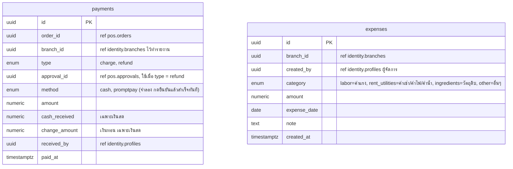

- ไม่มี FK ภายใน service นี้ ทุกฟิลด์อ้างข้าม service · `payments` เก็บ `branch_id` ซ้ำไว้ทำรายงานโดยไม่ต้องเรียก pos
- PromptPay จำลอง: กดยืนยันแล้วบันทึก `charge` สำเร็จทันที ไม่ตรวจกับธนาคาร (`cash_received`/`change_amount` ว่าง)
- เมื่อรับเงินครบ payment เรียก pos ให้เปลี่ยน `orders.status = paid` โดยใช้ `order_id` กันเรียกซ้ำ
- รายรับ = Σ`charge` − Σ`refund` · กำไร = รายรับ − รายจ่ายรวมทุกหมวด แยก `branch_id` และเดือน (1.37)
- แดชบอร์ดอ่านยอดขาย/จำนวนบิล/เฉลี่ยต่อบิลจาก `payments` · เมนูขายดีเรียกจาก pos ผ่าน internal API

### membership (เฟส 2)

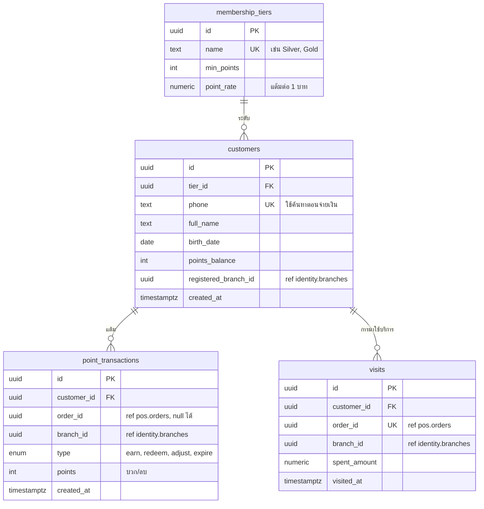

- `visits` บันทึกเมื่อบิลของสมาชิกปิด · heatmap ของทุกบิลใช้ `pos.orders.opened_at`

### coupon (เฟส 3)

คูปองที่ออกจากสาขาหนึ่งใช้ที่สาขาอื่นได้ โดยกำหนดสาขาที่ใช้ได้ใน `coupon_branches`

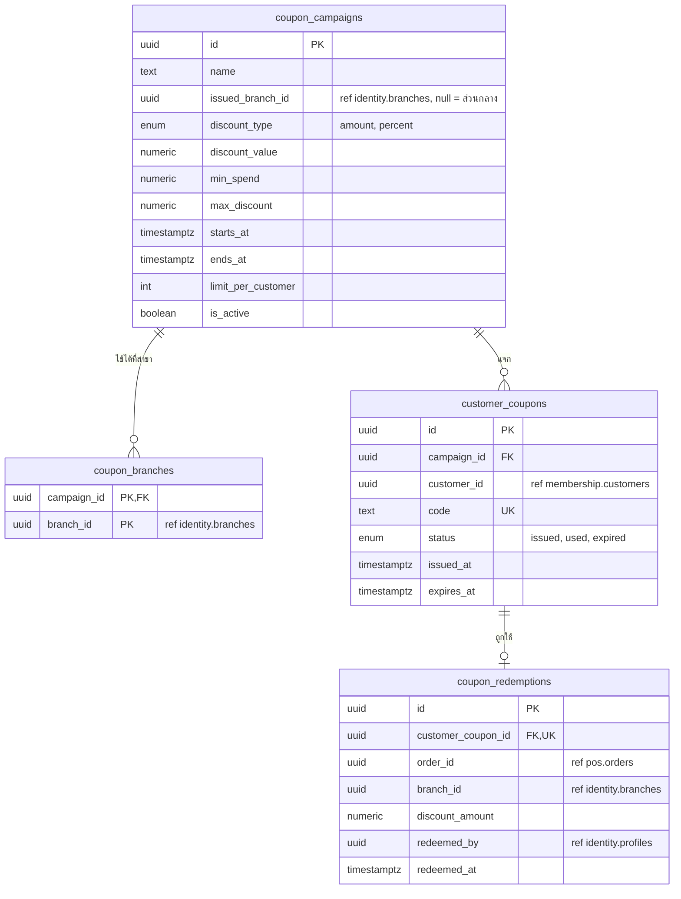

### สรุปจำนวนตาราง

| Service | ตาราง | เฟส |
|---|---|---|
| identity | 3 (+ auth.users ของ Supabase) | 1 |
| catalog | 6 | 1 |
| pos | 8 | 1 |
| payment | 2 | 1 |
| membership | 4 | 2 |
| coupon | 4 | 3 |
| **รวม** | **27** | |

---

## 4. API เฟส 1 (ผ่าน Gateway)

gateway ตัด prefix `/api/v1/<service>` ก่อนส่งต่อ เช่น `/api/v1/pos/orders` → pos เห็น `/orders`

| Prefix | Service |
|---|---|
| `/api/v1/identity/*` | identity :3001 |
| `/api/v1/catalog/*` | catalog :3002 |
| `/api/v1/pos/*` | pos :3003 |
| `/api/v1/payment/*` | payment :3004 |

### identity

| Method | Path | Role | คำอธิบาย |
|---|---|---|---|
| POST | `/auth/login` | public | username + password ได้ access/refresh token (1.2) |
| POST | `/auth/refresh` | public | ขอ access token ใหม่ |
| POST | `/auth/logout` | S M O | ออกจากระบบ |
| GET | `/me` | S M O | ข้อมูลตัวเอง role สาขา ใช้ซ่อน/แสดงเมนู (1.2) |
| GET | `/branches` | S M O | รายชื่อสาขา |
| POST | `/branches` | O | เพิ่มสาขา (1.6) |
| PATCH | `/branches/:id` | O | แก้ไขหรือปิดสาขา |
| DELETE | `/branches/:id` | O | soft delete (`is_active = false`) (1.6) |
| GET | `/roles` | M O | รายชื่อ role |
| GET | `/users` | M O | พนักงาน (manager เห็นเฉพาะสาขาตัวเอง) (1.3) |
| POST | `/users` | O | เพิ่มพนักงานและกำหนด role (1.5) |
| PATCH | `/users/:id` | O | แก้ไข เปลี่ยน role ย้ายสาขา (1.5) |
| DELETE | `/users/:id` | O | soft delete + ยกเลิก session (1.5) |

### catalog

| Method | Path | Role | คำอธิบาย |
|---|---|---|---|
| GET | `/categories` | S M O | หมวดหมู่ |
| POST | `/categories` | O | เพิ่มหมวดหมู่ |
| PATCH | `/categories/:id` | O | แก้ไขหมวดหมู่ |
| GET | `/menus` | S M O | เมนูของสาขาพร้อมราคาและสถานะพร้อมขาย (`?category_id=`) · owner ส่ง `?branch_id=` |
| GET | `/menus/:id` | S M O | รายละเอียดเมนูพร้อมกลุ่มตัวเลือก |
| POST | `/menus` | M O | เพิ่มเมนูของสาขา (manager = สาขาตัวเอง, owner ส่ง `branch_id`) ระบุหมวด ชื่อ ราคา รูป · สร้างแถวสต็อก 0 ปิดขายให้อัตโนมัติ (1.14) |
| PATCH | `/menus/:id` | M O | แก้ชื่อ หมวด ราคา รายละเอียด รูป (เฉพาะเมนูของสาขาตัวเอง) (1.14) |
| DELETE | `/menus/:id` | M O | soft delete (`is_deleted = true`) (1.14) |
| POST | `/menus/:id/copy` | O | คัดลอกเมนูพร้อมกลุ่มตัวเลือกไปสาขาอื่น `{to_branch_id}` สต็อก 0 ปิดขาย |
| PATCH | `/menus/:id/availability` | S M O | เปิด/ปิดขายเมนูของสาขา `{is_available}` เปิดไม่ได้ถ้าสต็อก = 0 (409) (1.15) |
| PUT | `/menus/:id/option-groups` | M O | กำหนดกลุ่มตัวเลือกของเมนู (1.18) |
| GET | `/option-groups` | S M O | กลุ่มตัวเลือกของสาขาพร้อม options (owner ส่ง `?branch_id=`) |
| POST | `/option-groups` | M O | สร้างกลุ่มตัวเลือกของสาขา กำหนด `max_select` (owner ส่ง `branch_id`) (1.16) |
| PATCH | `/option-groups/:id` | M O | แก้ไขกลุ่มตัวเลือก (1.16) |
| POST | `/option-groups/:id/options` | M O | เพิ่มตัวเลือก พร้อม `extra_price` (1.17) |
| PATCH | `/options/:id` | M O | แก้ตัวเลือกและราคาบวกเพิ่ม (1.17) |
| GET | `/stocks` | M O | สต็อกของสาขา |
| PATCH | `/stocks/:menuId` | M O | `{quantity}` ตั้งค่า หรือ `{add}` เติมเพิ่ม (1.22) · ไม่เปลี่ยนสถานะเปิด/ปิดขาย ยกเว้นเหลือ 0 → ปิดเอง |

- ราคาที่แก้ใหม่ไม่กระทบบิลที่สั่งไปแล้ว เพราะ pos เก็บ snapshot ราคาตอนสั่ง · manager แก้/ลบ/ผูกได้เฉพาะเมนูและกลุ่มตัวเลือกของสาขาตัวเอง (gateway ใส่ `X-Branch-Id`, catalog ตรวจ `branch_id` ของข้อมูล)
- `quantity` จาก 0 → มากกว่า 0 **ไม่เปิดขายให้** staff เปิดเองด้วย `/availability` (1.22) · เหลือ 0 ระบบปิดขายให้เอง (1.21)

### pos

| Method | Path | Role | คำอธิบาย |
|---|---|---|---|
| GET | `/tables` | S M O | โต๊ะของสาขาพร้อมสถานะ (1.8) |
| POST | `/tables` | M O | เพิ่มโต๊ะ |
| PATCH | `/tables/:id` | M O | แก้ไขโต๊ะ |
| POST | `/orders` | S M | เปิดโต๊ะ/เปิดบิล `{table_ids, guest_count}` บันทึก `opened_at` (1.7) |
| GET | `/orders` | S M O | รายการบิล (`?status=&date=`) |
| GET | `/orders/:id` | S M O | บิลเต็ม: โต๊ะ ตั๋ว รายการ ส่วนลด `subtotal` `vat_amount` `total` ใช้พิมพ์ใบเสร็จ (1.23, 1.24) |
| POST | `/orders/:id/tables/move` | S M | ย้ายโต๊ะ `{from_table_id, to_table_id}` (1.11) |
| POST | `/orders/:id/tables/merge` | S M | รวมโต๊ะ `{table_ids}` (1.12) |
| POST | `/orders/:id/tickets` | S M | สั่งอาหาร 1 รอบ `{items:[{menu_id, quantity, note, option_ids}]}` ตอบข้อมูลพิมพ์ใบออร์เดอร์ (1.9, 1.10) |
| POST | `/orders/:id/request-payment` | S M | เรียกเก็บเงิน → `waiting_payment` คำนวณ VAT 7% (1.8, 1.24) |
| GET | `/kitchen/tickets` | S M | ตั๋วครัวของสาขา (`?status=`) |
| PATCH | `/kitchen/tickets/:id` | S M | เปลี่ยนสถานะ `preparing` / `served` |
| POST | `/orders/:id/approvals` | S | ขอส่วนลด/คืนเงิน `{type, value_type, value, reason, refund_items?}` (1.27, 1.28) |
| GET | `/approvals` | S M O | คำขอ (`?status=pending`) staff เห็นเฉพาะของตัวเอง, manager เห็นของสาขา, owner เห็นทุกสาขา (1.29) |
| GET | `/approvals/stream` | M O | SSE แจ้งคำขอใหม่ (ทางเลือกแทน Realtime) (1.29) |
| POST | `/approvals/:id/approve` | M O | อนุมัติ บันทึกผู้อนุมัติและเวลา (1.29, 1.31) |
| POST | `/approvals/:id/reject` | M O | ปฏิเสธ (1.29, 1.31) |

- ส่วนลดมีผลเมื่อ `approved` เท่านั้น → pos อัปเดต `discount_amount` และคำนวณ VAT/ยอดสุทธิใหม่ (1.30)
- ขอส่วนลดได้ตอนบิลยังไม่จ่าย · ขอคืนเงินได้เฉพาะบิลที่ `paid` (1.28)
- `vat = (subtotal − discount) × 0.07`, `total = subtotal − discount + vat`
- ไม่มี endpoint แยกบิล (1.13) · บิล `paid` แล้ว pos คืนโต๊ะทั้งหมดเป็น `available` (1.26)

### payment

| Method | Path | Role | คำอธิบาย |
|---|---|---|---|
| POST | `/payments` | S M | รับเงิน `{order_id, method, cash_received?}` เงินสดคืน `change_amount` · PromptPay: กดยืนยันแล้วบันทึกสำเร็จทันที (จำลอง) ต้องมี `Idempotency-Key` (1.23, 1.25) |
| POST | `/refunds` | S M | คืนเงินหลังอนุมัติ `{approval_id, method}` ไม่มี approval `approved` → 409 · ไม่คืนสต็อก (1.30) |
| GET | `/payments` | M O | รายการรับ/คืนเงิน (`?date=`) |
| GET | `/expenses` | M O | รายจ่าย (`?from=&to=&category=`) |
| POST | `/expenses` | M O | บันทึกรายจ่าย (manager เฉพาะสาขาตัวเอง, owner ส่ง `branch_id`) (1.32, 1.33) |
| PATCH | `/expenses/:id` | M O | แก้ไขรายจ่าย |
| DELETE | `/expenses/:id` | M O | ลบรายจ่าย |
| GET | `/reports/daily` | M O | `sales`, `refunds`, `net_sales`, `bill_count`, `avg_per_bill`, `top_menus`, `expenses` (`?date=`) (1.34, 1.35) |
| GET | `/reports/branches` | O | เปรียบเทียบทุกสาขา (`?from=&to=`) (1.36) |
| GET | `/reports/profit` | O | รายรับ รายจ่ายรวม กำไร แยกสาขาและเดือน (`?year=&branch_id=`) (1.37) |

### Internal API (ไม่ผ่าน gateway · ต้องส่ง `X-Internal-Key` · gateway บล็อก `/internal/*`)

| เรียกจาก | ไปยัง | Endpoint | ใช้ตอนไหน |
|---|---|---|---|
| pos | catalog | `POST /internal/menus/lookup` | ส่ง `branch_id` + รายการเมนู/ตัวเลือก (ต้องเป็นของสาขานั้น) ได้ชื่อและราคาไปเก็บเป็น snapshot |
| pos | catalog | `POST /internal/stocks/deduct` | ตัดสต็อกตอนสั่ง เหลือ 0 → ปิดขายอัตโนมัติ (1.20, 1.21) |
| pos | catalog | `POST /internal/stocks/restore` | คืนสต็อกเฉพาะเมื่อสั่งอาหารไม่สำเร็จ (rollback) · **ไม่เรียกตอนคืนเงิน** · ไม่เปิดขายอัตโนมัติ |
| payment | pos | `GET /internal/orders/:id/summary` | ยอดที่ต้องจ่าย (หลังส่วนลดอนุมัติ) + สถานะบิล |
| payment | pos | `POST /internal/orders/:id/mark-paid` | ปิดบิล คืนโต๊ะเป็นว่าง (เรียกซ้ำได้) |
| payment | pos | `POST /internal/orders/:id/mark-refunded` | อัปเดตสถานะหลังคืนเงิน (ไม่คืนสต็อก) |
| payment | pos | `GET /internal/reports/top-menus` | เมนูขายดี (`?branch_id=&from=&to=&limit=`) |

---

## 5. Flow สำคัญ

### สั่งอาหาร 1 รอบ

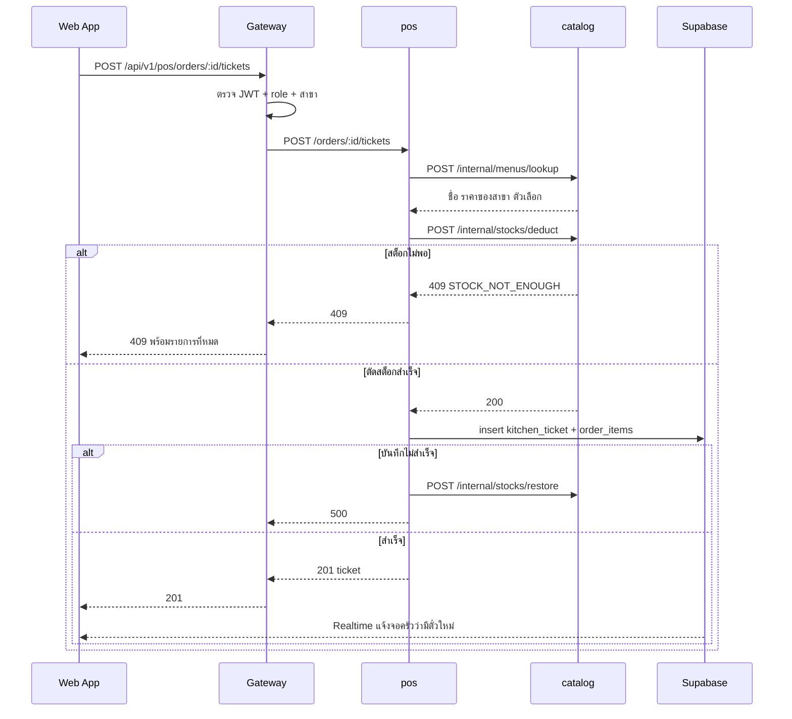

### รับเงิน

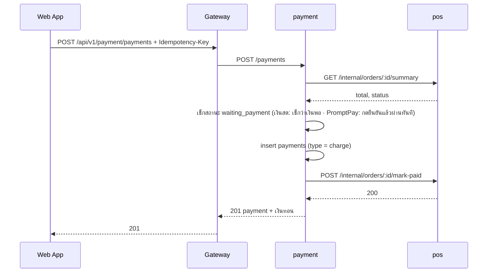

ถ้า pos ไม่ตอบตอน `mark-paid` ข้อมูลรับเงินบันทึกไว้แล้ว ให้ payment ลองเรียกซ้ำ ปลอดภัยเพราะ `mark-paid` ใช้ `order_id` กันทำซ้ำ

### ขอส่วนลด / คืนเงิน

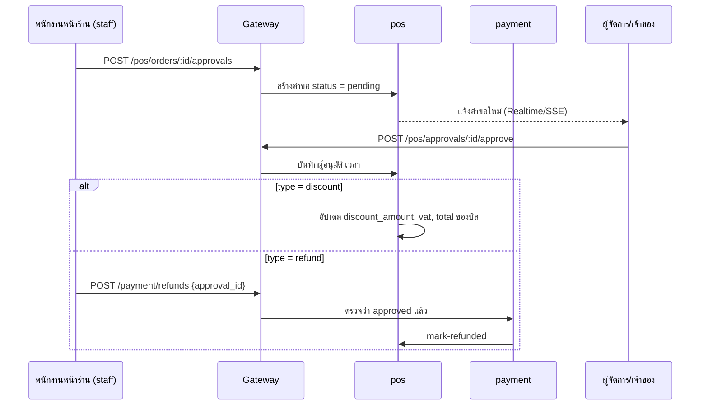

---

## 6. Realtime

**จอครัว:** login ด้วยบัญชี staff หรือ manager ของสาขา → subscribe Supabase Realtime ที่ `pos.kitchen_tickets` ด้วย JWT ผู้ใช้ · RLS select เฉพาะแถวที่ `branch_id` ตรง claim · Realtime ใช้แค่แจ้ง แล้วเรียก `GET /api/v1/pos/kitchen/tickets` ผ่าน gateway ดึงรายละเอียด · ถ้าไม่อยากเปิด schema `pos` ให้ client เห็น ใช้ SSE `GET /api/v1/pos/kitchen/stream` แทน

**แจ้งเตือนคำขออนุมัติ (1.29):** เครื่อง manager/owner subscribe `pos.approvals` แจ้งเฉพาะ insert ที่ `status = pending` · RLS: role ต้องเป็น manager/owner และ `branch_id` ตรง claim (owner ที่ไม่มี `branch_id` เห็นทุกสาขา) · ได้รับแจ้งแล้วเรียก `GET /api/v1/pos/approvals?status=pending` · ทางเลือก SSE: `GET /api/v1/pos/approvals/stream`

---

## 7. รูปแบบ response และเทคโนโลยี

```json
{ "data": { }, "meta": { "page": 1, "total": 42 } }
```

```json
{
  "error": { "code": "STOCK_NOT_ENOUGH", "message": "เมนูบางรายการหมด", "details": [ ] },
  "request_id": "b1f2..."
}
```

| HTTP | ใช้เมื่อ |
|---|---|
| 400 | ข้อมูลไม่ถูกต้อง (`VALIDATION_ERROR`) |
| 401 | ไม่ได้ login / token หมดอายุ |
| 403 | role หรือสาขาไม่มีสิทธิ์ |
| 404 | ไม่พบข้อมูล |
| 409 | สถานะไม่ถูกต้อง เช่น สต็อกไม่พอ บิลจ่ายแล้ว คำขอยังไม่อนุมัติ |
| 429 | เรียกถี่เกินไป |
| 502 / 504 | service ปลายทางล่ม/ตอบช้า |

| ส่วน | ตัวเลือก |
|---|---|
| Frontend | React (Vite) |
| Gateway | Node.js + Express + `http-proxy-middleware` |
| ตรวจ JWT | `jose` (JWKS) |
| Rate limit | `express-rate-limit` |
| Validation | `zod` |
| รัน | Docker Compose เปิดแค่ gateway port 8080 |
| Health check | `GET /health` ของ gateway รวมสถานะ 4 service |

```js
const routes = [
  { prefix: '/api/v1/identity', target: 'http://identity:3001', public: ['/auth/login', '/auth/refresh'] },
  { prefix: '/api/v1/catalog',  target: 'http://catalog:3002' },
  { prefix: '/api/v1/pos',      target: 'http://pos:3003' },
  { prefix: '/api/v1/payment',  target: 'http://payment:3004' },
];
```

ตารางสิทธิ์ในข้อ 4 เขียนเป็น config `{ method, path, roles }` ให้ route guard อ่าน จะได้แก้สิทธิ์ที่เดียว

---

## 8. แบ่งงานเฟส 1 — Dev 3 คน (DB ใครของมัน)

หลักการ: 1 service = 1 schema = 1 เจ้าของ ไม่มีใครแตะตารางของคนอื่น คุยกันผ่าน API เท่านั้น

| Dev | Service / Schema | ตาราง | งานเสริม |
|---|---|---|---|
| Dev 1 | identity | branches, roles, profiles (3) | API Gateway, JWT hook, Docker Compose, layout พิมพ์ใบออร์เดอร์/ใบเสร็จ |
| Dev 2 | catalog + payment | categories, menus, option_groups, options, menu_option_groups, stocks, payments, expenses (8) | รายงาน/แดชบอร์ด |
| Dev 3 | pos | dining_tables, orders, order_tables, kitchen_tickets, order_items, order_item_options, approvals, refund_items (8) | จอครัว + แจ้งเตือนอนุมัติ realtime, VAT |

### Dev 1 — identity + gateway (1.1–1.6)

- schema identity, custom access token hook (ใส่ `user_role`, `branch_id` ลง JWT)
- seed ตาราง `roles`: staff, manager, owner (staff = waiter + cashier รวมกัน)
- API: auth login/refresh/logout, me, branches (เพิ่ม/แก้/ลบ), roles, users (O เพิ่ม/แก้/ลบ, manager ดูเฉพาะสาขาตัวเอง)
- Gateway ครบ 10 middleware · route guard เป็น config `{method, path, roles}`
- Docker Compose ทั้งระบบ (เปิดแค่ 8080), `.env` ตัวอย่าง, `X-Internal-Key`
- shared package: รูปแบบ response/error, zod helper, middleware อ่าน header `X-User-*`
- Frontend: login, layout + เมนูตาม role (1.2), หน้าจัดการผู้ใช้และสาขา
- **1.10 ส่วนพิมพ์:** layout ใบออร์เดอร์เข้าครัวและใบเสร็จ (ก่อน VAT / VAT / สุทธิ)
- **ส่งมอบก่อนใคร (สัปดาห์แรก):** gateway + token ทดสอบ 3 role (staff, manager, owner)

### Dev 2 — catalog + payment + รายงาน (1.14–1.22, 1.25, 1.32–1.37 และฝั่งเงินของ 1.23, 1.28)

- catalog: หมวดหมู่ (owner เท่านั้น) · เมนูและกลุ่มตัวเลือกเป็นของแต่ละสาขา (`branch_id`) รูปใน Supabase Storage — manager จัดการเฉพาะสาขาตัวเอง, owner ทุกสาขา (1.14, 1.16–1.18)
- ราคาอยู่ใน `menus.price` (แก้ผ่าน `PATCH /menus/:id`) · `POST /menus/:id/copy` ให้ owner คัดลอกเมนูข้ามสาขา
- `PATCH /menus/:id/availability` — S M O (1.15)
- สต็อกของเมนู เติม/แก้ (`quantity` / `add`) (1.19, 1.22) · เหลือ 0 → ปิดขายอัตโนมัติ (1.21) · **จาก 0 → มากกว่า 0 ไม่เปิดขายเอง**
- internal API: `menus/lookup` (ตรวจว่าเมนูเป็นของสาขา), `stocks/deduct`, `stocks/restore` (atomic กัน race; restore ใช้เฉพาะ rollback) (1.20)
- payment: เงินสด + ทอน, PromptPay จำลอง กดแล้วสำเร็จทันที, `Idempotency-Key`, คืนเงินหลังอนุมัติ (ไม่คืนสต็อก) (1.25, 1.30)
- expenses 4 หมวด manager บันทึกของสาขาตัวเอง (1.32, 1.33)
- รายงาน: `/reports/daily`, `/reports/branches`, `/reports/profit` (1.34–1.37)
- Frontend: หน้าเมนู/ตัวเลือก/สต็อก, หน้าคิดเงิน, หน้ารายจ่าย, แดชบอร์ด manager และ owner

### Dev 3 — pos (1.7–1.13, 1.20 ฝั่งเรียกตัดสต็อก, 1.23–1.24, 1.26–1.31)

- โต๊ะ 3 สถานะ, เปิดโต๊ะ + จำนวนลูกค้า + `opened_at` (1.7, 1.8)
- สั่งหลายรอบ = `kitchen_tickets` + `order_items` + snapshot (1.9) เรียก catalog lookup (ส่ง `branch_id`)/deduct/restore
- ย้ายโต๊ะ, รวมโต๊ะ, ไม่ทำแยกบิล (1.11–1.13)
- คำนวณ subtotal / ส่วนลด / VAT 7% / total (1.24) + `request-payment`
- internal สำหรับ payment: `orders/:id/summary`, `mark-paid`, `mark-refunded`, `reports/top-menus` (mark-paid → โต๊ะว่าง 1.26)
- ส่วนลด/คืนเงิน: staff ขอ → แจ้ง M/O realtime/SSE → อนุมัติ/ปฏิเสธ → ใช้เฉพาะที่อนุมัติ + log (1.27–1.31) · คืนเงินไม่คืนสต็อก
- จอครัว: Realtime/SSE + `GET /kitchen/tickets`
- `branch_id` ใน `kitchen_tickets` และ `approvals` + RLS
- Frontend: ผังโต๊ะ, สั่งอาหาร, จอครัว, หน้าขออนุมัติ (staff), กล่องแจ้งเตือน/อนุมัติ (M/O)

### ลำดับทำงานที่แนะนำ

1. ทั้ง 3 คน: ตกลง contract ของ internal API + ใช้ header จำลอง `X-User-*` ทดสอบก่อน gateway เสร็จ
2. Dev 1: gateway + login ก่อน / Dev 2: catalog + stock + ราคา / Dev 3: โต๊ะ + เปิดบิล
3. Dev 3 สั่งอาหารเมื่อ Dev 2 มี lookup/deduct (mock ไปก่อนได้)
4. Dev 2 ทำ payment เมื่อ Dev 3 มี `summary` / `mark-paid`
5. ส่วนลด/คืนเงินและแจ้งเตือนอนุมัติ ทำหลังรับเงินได้แล้ว
6. รายงาน/แดชบอร์ดทำท้ายสุด เมื่อมีข้อมูลบิลจริง

---

## 9. ประเด็นที่ตัดสินใจแล้ว และที่ยังเปิดอยู่

**ตัดสินใจแล้ว**

1. เมนูและกลุ่มตัวเลือกเป็นของแต่ละสาขา (`branch_id`) manager แก้ได้เฉพาะสาขาตัวเอง · หมวดหมู่เป็นของกลาง owner เท่านั้น (ร้านเหล้า/อาหาร/คาเฟ่ หมวดใกล้เคียงกัน)
2. คืนเงินไม่คืนสต็อก
3. เติมสต็อกจาก 0 ไม่เปิดขายเอง staff เปิดเอง
4. PromptPay กดยืนยันแล้วสำเร็จทันที
5. waiter + cashier รวมเป็น `staff`

**ยังเปิดอยู่**

1. **ราคาเมนูรวม VAT หรือยัง:** ตอนนี้สมมติว่ายังไม่รวม (`total = subtotal − discount + vat`)
2. **ขอส่วนลด/คืนเงิน:** ตอนนี้ขอได้เฉพาะ staff และอนุมัติโดย manager/owner ถ้ามีวันที่ manager/owner อยู่หน้าเคาน์เตอร์คนเดียว ต้องตัดสินใจว่าให้ส่วนลด/คืนเงินเองได้เลยหรือไม่
3. **คัดลอกเมนูข้ามสาขา:** คัดลอกครั้งเดียว ไม่ตามกันภายหลัง (ถ้าต้องการให้แก้ที่ต้นฉบับแล้วตามไปทุกสาขา ต้องออกแบบเพิ่ม)
4. **Endpoint SSE ของจอครัว** (`/kitchen/stream`) ยังไม่อยู่ในตารางสิทธิ์ ถ้าเลือกใช้แทน Realtime ต้องเพิ่ม (S M)
